# Plataforma de Votación Electrónica
## 1. Contextualización del Tema

### 1.1 ¿Qué es una Plataforma de Votación Electrónica?
Una plataforma de votación electrónica es un sistema de información diseñado para registrar, procesar, tabular y auditar sufragios de manera digital, ya sea en puestos de votación presenciales (mediante dispositivos de registro directo o DRE) o de forma remota a través de redes seguras.

A nivel global, la adopción del voto electrónico busca mejorar la eficiencia en la tabulación de resultados, reducir el uso de papel, eliminar errores humanos en el escrutinio de mesas y permitir la entrega de resultados preliminares en tiempos reducidos. Países como Estonia han consolidado modelos de voto por internet, mientras que otros como Brasil utilizan urnas electrónicas presenciales con respaldo digital.

### 1.2 Problemática de los Procesos Electorales Tradicionales
Los métodos de votación tradicionales basados en papeletas físicas presentan desafíos recurrentes que impactan la eficiencia y la confianza en los resultados:
* **Errores humanos y lentitud en el escrutinio:** El conteo manual de votos es un proceso dispendioso y propenso a equivocaciones al momento de tabular y diligenciar las actas físicas.
* **Riesgos de custodia e integridad:** El transporte y almacenamiento de material electoral físico implica riesgos de extravío, daño o alteración de votos.
* **Altos costos logísticos:** Requieren una gran inversión de recursos en la impresión de tarjetones, distribución de material y despliegue de personal.
* **Dificultad de auditoría y verificación:** El recuento físico de votos ante controversias o inconsistencias es complejo y demorado, lo que suele generar incertidumbre en los participantes.

### 1.3 El Dilema Central del Voto Digital
En la ingeniería de software, diseñar un sistema electoral representa un reto singular debido a que debe satisfacer dos principios fundamentales:
1. **Secreto del Voto (Anonimato):** Nadie (ni los administradores del sistema, ni los auditores, ni otros votantes) debe poder asociar la identidad de un ciudadano con su elección específica.
2. **Integridad y Verificabilidad (Auditabilidad):** Cada voto emitido debe ser registrado exactamente como el votante lo expresó, sin alteraciones, y debe ser posible auditar que el conteo final corresponde con la totalidad de los votos emitidos.

Adicionalmente, se deben mitigar riesgos como la coerción, el fraude informático, la suplantación de identidad, la denegación de servicio (DoS) y la pérdida de confianza de los participantes.

---

## 2. Objetivos del Proyecto

### 2.1 Objetivo General
Desarrollar un prototipo funcional de una **Plataforma de Votación Electrónica** que permita simular un proceso electoral, facilitando la autenticación de votantes, la emisión anónima del voto, el conteo automatizado de resultados y el registro de auditoría de la jornada.

### 2.2 Objetivos Específicos
1. **Permitir la configuración de la jornada electoral:** Facilitar el registro de los candidatos y opciones de votación necesarios para llevar a cabo el proceso electoral.
2. **Implementar el control de acceso y validación de votantes:** Desarrollar un mecanismo para autenticar a los electores y verificar que solo puedan ejercer su derecho al voto una única vez.
3. **Garantizar el secreto y la privacidad del voto:** Diseñar la lógica de emisión de papeletas digitales de forma que la identidad del usuario no quede vinculada a la opción seleccionada.
4. **Construir el motor de conteo automatizado:** Desarrollar el módulo encargado de registrar, tabular y totalizar los votos emitidos para presentar los resultados del escrutinio de manera precisa.
5. **Crear un registro de eventos y auditoría:** Implementar un sistema de registro cronológico (*logs*) para rastrear eventos clave (apertura de votación, emisión de votos, cierre de jornada y emisión de resultados), permitiendo verificar la transparencia del proceso.

---

## 3. Arquitectura y Diseño del Sistema

### 3.1 Diagrama de Clases (UML)
El siguiente diagrama representa el modelo de clases y la relación estructural entre los módulos de configuración, emisión de votos y parametrización de elecciones del sistema:

```mermaid
classDiagram
    direction TB

    %% MÓDULO CORE - SINGLETON
    class ElectoralConfigManager {
        -ElectoralConfigManager _instance$
        -Lock _lock$
        -bool _initialized$
        +str institution_name
        +str election_title
        +int max_votes_per_citizen
        -_bool _is_open
        +is_open() bool
        +open_voting() void
        +close_voting() void
        +reset_for_testing()$ void
    }

    %% MÓDULO VOTING - FACTORY METHOD
    class Ballot {
        <<abstract>>
        +str ballot_id
        +datetime issued_at
        +get_selection()* str
    }
    class CandidateBallot {
        +str candidate_id
        +str candidate_name
        +str party_name
        +get_selection() str
    }
    class ReferendumBallot {
        +str question_code
        +str decision
        +get_selection() str
    }
    class BlankBallot {
        +str category
        +get_selection() str
    }
    Ballot <|-- CandidateBallot
    Ballot <|-- ReferendumBallot
    Ballot <|-- BlankBallot

    class BallotCreator {
        <<abstract>>
        +create_ballot(**kwargs)* Ballot
        +issue_ballot(**kwargs) Ballot
    }
    class CandidateBallotCreator {
        +create_ballot(**kwargs) CandidateBallot
    }
    class ReferendumBallotCreator {
        +create_ballot(**kwargs) ReferendumBallot
    }
    class BlankBallotCreator {
        +create_ballot(**kwargs) BlankBallot
    }
    BallotCreator <|-- CandidateBallotCreator
    BallotCreator <|-- ReferendumBallotCreator
    BallotCreator <|-- BlankBallotCreator
    BallotCreator ..> Ballot : crea

    %% MÓDULO ELECTION - ABSTRACT FACTORY
    class CredentialValidator {
        <<abstract>>
        +validate_credential(document_id)* bool
        +get_document_type()* str
    }
    class NationalCitizenValidator {
        +validate_credential(document_id) bool
        +get_document_type() str
    }
    class StudentCodeValidator {
        +validate_credential(document_id) bool
        +get_document_type() str
    }
    CredentialValidator <|-- NationalCitizenValidator
    CredentialValidator <|-- StudentCodeValidator

    class BallotHeader {
        <<abstract>>
        +render_header()* str
    }
    class NationalBallotHeader {
        +render_header() str
    }
    class UniversityBallotHeader {
        +render_header() str
    }
    BallotHeader <|-- NationalBallotHeader
    BallotHeader <|-- UniversityBallotHeader

    class TallyRule {
        <<abstract>>
        +evaluate_winner(votes_summary)* str
    }
    class AbsoluteMajorityTallyRule {
        +evaluate_winner(votes_summary) str
    }
    class SimplePluralityTallyRule {
        +evaluate_winner(votes_summary) str
    }
    TallyRule <|-- AbsoluteMajorityTallyRule
    TallyRule <|-- SimplePluralityTallyRule

    class ElectoralFamilyFactory {
        <<abstract>>
        +create_validator()* CredentialValidator
        +create_header()* BallotHeader
        +create_tally_rule()* TallyRule
    }
    class NationalElectionFactory {
        +create_validator() CredentialValidator
        +create_header() BallotHeader
        +create_tally_rule() TallyRule
    }
    class UniversityElectionFactory {
        +create_validator() CredentialValidator
        +create_header() BallotHeader
        +create_tally_rule() TallyRule
    }
    ElectoralFamilyFactory <|-- NationalElectionFactory
    ElectoralFamilyFactory <|-- UniversityElectionFactory
    ElectoralFamilyFactory ..> CredentialValidator : fabrica
    ElectoralFamilyFactory ..> BallotHeader : fabrica
    ElectoralFamilyFactory ..> TallyRule : fabrica

    %% MÓDULO TALLY - BUILDER
    class ElectoralTallyReport {
        +str election_title
        +str jurisdiction
        +datetime generated_at
        +List~str~ table_ids
        +Dict candidate_votes
        +int blank_votes
        +int null_votes
        +int total_votes
        +List~str~ officer_signatures
        +str integrity_hash
        +to_formatted_summary() str
    }
    class TallyReportBuilder {
        <<abstract>>
        +reset()* TallyReportBuilder
        +set_header(election_title, jurisdiction)* TallyReportBuilder
        +add_table_batch(table_ids)* TallyReportBuilder
        +set_votes(candidate_votes, blank_votes, null_votes)* TallyReportBuilder
        +add_officer_signature(signature_code)* TallyReportBuilder
        +build()* ElectoralTallyReport
    }
    class OfficialTallyReportBuilder {
        +reset() OfficialTallyReportBuilder
        +set_header(election_title, jurisdiction) OfficialTallyReportBuilder
        +add_table_batch(table_ids) OfficialTallyReportBuilder
        +set_votes(candidate_votes, blank_votes, null_votes) OfficialTallyReportBuilder
        +add_officer_signature(signature_code) OfficialTallyReportBuilder
        +build() ElectoralTallyReport
    }
    class TallyReportDirector {
        -TallyReportBuilder _builder
        +construct_preliminary_bulletin(title, jurisdiction, tables, votes) ElectoralTallyReport
    }
    TallyReportBuilder <|-- OfficialTallyReportBuilder
    OfficialTallyReportBuilder ..> ElectoralTallyReport : construye
    TallyReportDirector o-- TallyReportBuilder

    %% MÓDULO ELECTION - PROTOTYPE
    class Prototype~T~ {
        <<interface>>
        +clone()* T
    }
    class VotingStation {
        +str station_id
        +str polling_place
        +str zone_code
        +List~str~ allowed_ballot_types
        +str hardware_terminal_code
        +bool is_active
        +List~str~ assigned_officers
        +clone() VotingStation
        +assign_station(new_station_id, new_terminal_code, new_officers) VotingStation
    }
    class StationPrototypeRegistry {
        -Dict _prototypes
        +register_prototype(prototype_key, station) void
        +get_clone(prototype_key) VotingStation
    }
    Prototype <|.. VotingStation
    StationPrototypeRegistry o-- VotingStation
```



---

## 4. Avances del Proyecto

La documentación completa de los avances del proyecto (abarcando los 5 patrones Creacionales y los 7 patrones Estructurales del catálogo GoF) se encuentra detallada en la carpeta `avances/` y enlazada a continuación:

### 4.1 Avance 1: Implementación del Patrón Singleton
* **Módulo:** `src/core/config.py` (`ElectoralConfigManager`).
* **Resumen:** Se centralizó el estado y la configuración global de la jornada electoral garantizando una única instancia en memoria con soporte de concurrencia segura (*thread-safety*) mediante *Double-Checked Locking*. Se implementó control de re-inicialización y un método de aislamiento para pruebas automatizadas.
* **Documentación:** [Lectura en línea (Markdown)](avances/avance_1/patron_singleton.md) | [Descargar documento oficial (.docx)](<avances/avance_1/Avance Patrón de Diseño Singleton.docx>)

### 4.2 Avance 2: Implementación del Patrón Factory Method
* **Módulo:** `src/modules/voting/ballot_factory.py` (`BallotCreator` y jerarquía `Ballot`).
* **Resumen:** Se desacopló la lógica de emisión de votos de la instanciación concreta de papeletas electorales (`CandidateBallot`, `ReferendumBallot`, `BlankBallot`). Cumple con el principio Open/Closed (OCP), permitiendo incorporar nuevas modalidades de voto sin modificar el código base.
* **Documentación:** [Lectura en línea (Markdown)](avances/avance_2/patron_factory_method.md) | [Descargar documento oficial (.docx)](<avances/avance_2/Avance Patrón de Diseño Factory Method.docx>)

### 4.3 Avance 3: Implementación del Patrón Abstract Factory
* **Módulo:** `src/modules/election/election_factory.py` (`ElectoralFamilyFactory`).
* **Resumen:** Se implementó la creación de familias completas y coherentes de componentes según la jurisdicción de la elección (Nacional vs. Universitaria), abarcando validación de identidad, membrete oficial de papeleta y reglas de decisión para el escrutinio, garantizando la inversión de dependencias (DIP).
* **Documentación:** [Lectura en línea (Markdown)](avances/avance_3/patron_abstract_factory.md) | [Descargar documento oficial (.docx)](<avances/avance_3/Avance Patrón de Diseño Abstract Factory.docx>)

### 4.4 Avance 4: Implementación del Patrón Builder
* **Módulo:** `src/modules/tally/report_builder.py` (`TallyReportBuilder` y `ElectoralTallyReport`).
* **Resumen:** Se implementó la construcción progresiva y desacoplada del Acta Oficial de Escrutinio y Cierre de Urnas, evitando el antipatrón de constructor telescópico. Garantiza la inmutabilidad de los cómputos consolidados y añade sellado digital automático mediante hash criptográfico SHA-256.
* **Documentación:** [Lectura en línea (Markdown)](avances/avance_4/patron_builder.md) | [Descargar documento oficial (.docx)](<avances/avance_4/Avance Patrón de Diseño Builder.docx>)

### 4.5 Avance 5: Implementación del Patrón Prototype
* **Módulo:** `src/modules/election/station_prototype.py` (`VotingStation` y `StationPrototypeRegistry`).
* **Resumen:** Se formalizó la clonación y replicación rápida de mesas y estaciones de votación a partir de plantillas operativas preconfiguradas. Se implementó copia profunda (*deep copy*) para asegurar el aislamiento de colecciones mutables (jurados y tarjetones autorizados) y personalización segura de terminales.
* **Documentación:** [Lectura en línea (Markdown)](avances/avance_5/patron_prototype.md) | [Descargar documento oficial (.docx)](<avances/avance_5/Avance Patrón de Diseño Prototype.docx>)

### 4.6 Avance 6: Implementación de los Patrones Adapter y Bridge
* **Módulos:** `src/modules/census/census_adapter.py` (`ICensusRegistry`, `JsonCensusAdapter`, `CsvCensusAdapter`) y `src/modules/transmission/bulletin_bridge.py` (`ElectoralBulletin`, `ITransmissionChannel`).
* **Resumen:** Se implementó el patrón **Adapter** para homogeneizar censos electorales de fuentes heterogéneas (archivos planos CSV de Registraduría vs exportaciones JSON institucionales) hacia el modelo canónico del dominio. En paralelo, se implementó el patrón **Bridge** para desacoplar los tipos de boletines y alertas electorales de sus canales físicos de transporte (consola oficial, archivo persistente sellado y sink de auditoría en memoria), evitando la explosión combinatoria multidimensional.
* **Documentación:** [Lectura en línea (Markdown)](avances/avance_6/patron_adapter_bridge.md)

### 4.7 Avance 7: Implementación de los Patrones Composite, Decorator y Facade
* **Módulos:** `src/modules/election/jurisdiction_composite.py` (`ElectoralUnit`, `VotingStationLeaf`, `ElectoralJurisdictionComposite`), `src/modules/voting/ballot_decorator.py` (`BallotSecurityDecorator`, `TimestampSecurityDecorator`, `DigitalSignatureDecorator`, `AuditWatermarkDecorator`), y `src/modules/facade/voting_facade.py` (`VotingSystemFacade`).
* **Resumen:** Se implementó el patrón **Composite** para estructurar jerárquicamente el censo y mesas de votación (País -> Departamento/Puesto -> Mesa) tratando unidades individuales y agrupaciones de forma uniforme. Se implementó el patrón **Decorator** (profundización) para envolver dinámicamente las papeletas con capas de seguridad acumulativas (sello de tiempo ISO-8601, firma criptográfica HMAC-SHA256 y marca de agua de auditoría) sin alterar la clase base `Ballot`. Finalmente, se integró el patrón **Facade** como punto de entrada unificado que coordina todos los subsistemas creacionales y estructurales de cara a la interfaz web y la API REST.
* **Documentación:** [Lectura en línea (Markdown)](avances/avance_7/patron_composite_decorator_facade.md)

### 4.8 Avance 8: Implementación de los Patrones Proxy y Flyweight
* **Módulos:** `src/modules/security/access_proxy.py` (`ElectoralAccessProxy`, `UserSession`, `UserRole`) y `src/modules/voting/candidate_flyweight.py` (`CandidateMetadataFlyweight`, `CandidateFlyweightFactory`).
* **Resumen:** Se implementó el patrón **Proxy** como sustituto protector que intercepta operaciones críticas del sistema electoral (apertura/cierre de urnas y emisión de votos) validando credenciales y roles (`ADMINISTRADOR`, `JURADO`, `AUDITOR`), además de registrar una bitácora inmutable de auditoría forense. En paralelo, se implementó el patrón **Flyweight** para compartir metadatos intrínsecos inmutables de los candidatos en memoria RAM, evitando duplicar texto y datos pesados al escalar a cientos de miles de sufragios. Con esto se completaron los **7 patrones estructurales** del catálogo GoF.
* **Documentación:** [Lectura en línea (Markdown)](avances/avance_8/patron_proxy_flyweight.md)

---

## 5. Instrucciones de Ejecución y Pruebas del Sistema

### 5.1 Requisitos Previos
* **Python 3.11 o superior** instalado en el sistema.
* Entorno virtual de Python configurado.

### 5.2 Configuración del Entorno Virtual e Instalación de Dependencias
```bash
# 1. Crear el entorno virtual en la raíz del proyecto
python3 -m venv venv

# 2. Activar el entorno virtual
source venv/bin/activate

# 3. Instalar las dependencias oficiales del sistema
pip install -r requirements.txt
```

### 5.3 Ejecución de la Plataforma Web y API
Para iniciar el servidor interactivo con recarga automática:
```bash
python3 -m src.main
# O directamente mediante Uvicorn:
uvicorn src.main:app --host 127.0.0.1 --port 8000 --reload
```

Una vez levantado el servidor, accede desde cualquier navegador a los siguientes módulos:
* **Cabina de Votación Digital (Elector):** [http://127.0.0.1:8000/](http://127.0.0.1:8000/)
  - Terminal limpia y sobria para el ciudadano/estudiante (sin anotaciones técnicas internas).
  - Digita tu documento habilitado según el modo activo.
  - Selecciona un candidato o **Voto en Blanco** (con retroalimentación visual de alto contraste inspirada en la *Urna Eletrônica* de Brasil).
  - Emite el sufragio y obtén tu **Comprobante Digital con Sello de Tiempo y Firma HMAC** (Decorator).
  - Al hacer clic en *Ver Resultados en Vivo*, serás dirigido al panel público sin riesgos de tocar controles de jurados.
* **Panel de Transmisión de Resultados en Vivo (Público):** [http://127.0.0.1:8000/dashboard](http://127.0.0.1:8000/dashboard)
  - Visualización transparente en vivo para electores y observadores.
  - Gráfico dinámico Chart.js y tabla de desglose porcentual en tiempo real.
  - **No contiene botones administrativos destructivos.**
* **Panel de Control Electoral y Jurados (Administración):** [http://127.0.0.1:8000/admin](http://127.0.0.1:8000/admin)
  - **Conmutador de Familia (Abstract Factory):** Alterna en caliente entre la *Elección Nacional (CNE)* y las *Elecciones Universitarias / Voceros (UDI)*.
  - **Control Operativo de Urna (Proxy):** Abrir y cerrar la jornada con credenciales protegidas de Administrador.
  - **Cierre y Escrutinio Definitivo (Builder):** Emite el Acta Oficial inmutable con hash SHA-256 y muestra el veredicto oficial de victoria emitido por la `TallyRule` (Mayoría Absoluta vs. Mayoría Simple).
  - **Bitácora de Auditoría Forense (Proxy):** Inspecciona en vivo cada evento interceptado por el sistema.
* **Documentación Interactiva Swagger UI:** [http://127.0.0.1:8000/docs](http://127.0.0.1:8000/docs)
  - Prueba interactivamente cada endpoint REST (`/api/election/mode`, `/api/election/switch-mode`, `/api/auth/verify`, `/api/votes/cast`, `/api/tally/generate`).

### 5.4 Credenciales de Prueba en el Censo Electoral
Para realizar pruebas demostrativas de sufragio y rechazo:
* **Modo Nacional (CNE - Cédula de Ciudadanía):**
  - **Habilitados:** `10203040` (Laura Restrepo), `50607080` (Andrés Cepeda), `70809010` (Mariana Pajón), `80901020` (Julián Román).
  - **Inhabilitado judicialmente:** `99999999` (Carlos Vives).
* **Modo Universitario (UDI - Carnet Estudiantil):**
  - **Habilitados:** `EST-2024` (Laura Restrepo), `EST-9012` (Andrés Cepeda), `EST-3341` (Mariana Pajón), `EST-5520` (Julián Román).
  - **Inhabilitado / Sancionado:** `EST-9999` (Carlos Vives).

### 5.5 Ejecución de la Suite de Pruebas Automatizadas (Pytest)
El proyecto cuenta con una suite completa de pruebas unitarias y de integración que valida el 100% de los patrones, conmutación de familias y endpoints:
```bash
# Ejecutar todas las pruebas con reporte de cobertura en consola
pytest tests/ --cov=src --cov-report=term-missing
```
* **Resultado actual:** **10 pruebas pasando (100%)** con una cobertura del **87%** sobre todo el código fuente.

---

## 6. Demostración Visual y Próximos Pasos

A partir de este hito, el prototipo es completamente funcional e interactivo:
* **Autenticación e Ingreso:** Validación de identidad del elector contra el Censo (Adapter) y control de voto único (Proxy).
* **Cabina de Votación Digital:** Selección interactiva de candidatos (Flyweight) y emisión anónima con sellos de seguridad (Decorator).
* **Panel de Escrutinio y Resultados:** Visualización gráfica en tiempo real (Chart.js) y generación del acta sellada con SHA-256 (Builder).