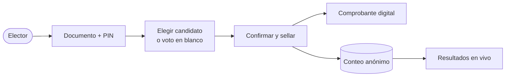

# Plataforma de Votación Electrónica

> Prototipo funcional local para demostración y aprendizaje. No está certificado para elecciones reales.

## 1. Contextualización del Tema

### 1.1 ¿Qué es una Plataforma de Votación Electrónica?
Una plataforma de votación electrónica es un sistema de información diseñado para registrar, procesar, tabular y auditar sufragios de manera digital, ya sea en puestos de votación presenciales (mediante dispositivos de registro directo o DRE) o de forma remota a través de redes seguras.

A nivel global, la adopción del voto electrónico busca mejorar la eficiencia en la tabulación de resultados, reducir el uso de papel, eliminar errores humanos en el escrutinio de mesas y permitir la entrega de resultados preliminares en tiempos reducidos. Países como Estonia han consolidado modelos de voto por internet, mientras que otros como Brasil utilizan urnas electrónicas presenciales con respaldo digital.

### 1.2 Problemática de los Procesos Electorales Tradicionales
Los métodos de votación tradicionales basados en papeletas físicas presentan desafíos recurrentes que impactan la eficiencia y la confianza en los resultados:
* **Errores humanos y lentitud en el escrutinio:** El conteo manual de votos es un proceso dispendioso y propenso a equivocaciones al momento de tabular y diligenciar las actas físicas.
* **Riesgos de custodia e integridad:** El transporte y almacenamiento de material electoral físico implica riesgos de extravío, daño o alteración de votos.
* **Altos costos logísticos:** Requieren una gran inversión de recursos en la impresión de tarjetones, distribución de material y despliegue de personal.
* **Dificultad de auditoría y verificación:** El recuento físico de votos ante controversias o inconsistencias es complejo y demorado, lo que suele generar incertidumbre en los participantes.

### 1.3 El Dilema Central del Voto Digital
En la ingeniería de software, diseñar un sistema electoral representa un reto singular debido a que debe satisfacer dos principios fundamentales:
1. **Secreto del Voto (Anonimato):** Nadie (ni los administradores del sistema, ni los auditores, ni otros votantes) debe poder asociar la identidad de un ciudadano con su elección específica.
2. **Integridad y Verificabilidad (Auditabilidad):** Cada voto emitido debe ser registrado exactamente como el votante lo expresó, sin alteraciones, y debe ser posible auditar que el conteo final corresponde con la totalidad de los votos emitidos.

Adicionalmente, se deben mitigar riesgos como la coerción, el fraude informático, la suplantación de identidad, la denegación de servicio (DoS) y la pérdida de confianza de los participantes.

---

## 2. Objetivos del Proyecto

### 2.1 Objetivo General
Desarrollar un prototipo funcional de una **Plataforma de Votación Electrónica** que permita simular un proceso electoral, facilitando la autenticación de votantes, la emisión anónima del voto, el conteo automatizado de resultados y el registro de auditoría de la jornada.

### 2.2 Objetivos Específicos
1. **Permitir la configuración de la jornada electoral:** Facilitar el registro de los candidatos y opciones de votación necesarios para llevar a cabo el proceso electoral.
2. **Implementar el control de acceso y validación de votantes:** Desarrollar un mecanismo para autenticar a los electores y verificar que solo puedan ejercer su derecho al voto una única vez.
3. **Garantizar el secreto y la privacidad del voto:** Diseñar la lógica de emisión de papeletas digitales de forma que la identidad del usuario no quede vinculada a la opción seleccionada.
4. **Construir el motor de conteo automatizado:** Desarrollar el módulo encargado de registrar, tabular y totalizar los votos emitidos para presentar los resultados del escrutinio de manera precisa.
5. **Crear un registro de eventos y auditoría:** Implementar un sistema de registro cronológico (*logs*) para rastrear eventos clave (apertura de votación, emisión de votos, cierre de jornada y emisión de resultados), permitiendo verificar la transparencia del proceso.

---

## 3. Cómo Funciona la Plataforma

### 3.1 Roles de la plataforma

| Rol | Qué puede hacer |
|---|---|
| **Elector** | Identificarse con documento y PIN, elegir un candidato o el voto en blanco, emitir el voto y recibir un comprobante. |
| **Administrador** | Abrir y cerrar la jornada, gestionar el censo, generar el acta de escrutinio y revisar la auditoría. |
| **Observador** | Consultar los resultados en vivo sin acceder a controles administrativos. |

### 3.2 Recorrido de un voto



En palabras simples:

1. El elector se identifica con su documento y su PIN.
2. El sistema verifica que esté habilitado y que no haya votado antes.
3. Elige un candidato o el voto en blanco.
4. Confirma: el voto se sella y se guarda de forma anónima.
5. Recibe un comprobante y los resultados se actualizan sin revelar por quién votó.

### 3.3 Funcionalidades principales

- **Cabina de votación digital** con autenticación por documento y PIN.
- **Voto para candidato o voto en blanco**, con confirmación y comprobante.
- **Resultados en vivo** con gráficos y porcentajes de participación.
- **Panel administrativo protegido** para abrir y cerrar la jornada, gestionar el censo, generar el acta y revisar la auditoría.
- **Dos modalidades electorales:** nacional (CNE) y universitaria (UDI).
- **Conmutación de modalidad** sin reiniciar la aplicación.

> Para el recorrido completo con capturas, consulta el [manual de uso](docs/manual_de_uso.md).

---

## 4. Documentación por Patrón

La plataforma se organizó con **12 patrones de diseño** agrupados en ocho documentos. Cada documento explica el problema, la solución, su diagrama y la relación con el código. El detalle técnico vive allí, no en este README.

| Documento | Qué aporta | Enlace |
|---|---|---|
| Configuración única (Singleton) | Mantener una sola configuración de la jornada electoral. | [Abrir](docs/avances/patron_singleton.md) |
| Creación de papeletas (Factory Method) | Crear distintos tipos de voto sin mezclar la lógica de emisión. | [Abrir](docs/avances/patron_factory_method.md) |
| Familias electorales (Abstract Factory) | Adaptar el sistema a elecciones nacionales y universitarias. | [Abrir](docs/avances/patron_abstract_factory.md) |
| Acta de escrutinio (Builder) | Construir el acta oficial paso a paso y con sello de integridad. | [Abrir](docs/avances/patron_builder.md) |
| Mesas de votación (Prototype) | Clonar mesas a partir de plantillas preconfiguradas. | [Abrir](docs/avances/patron_prototype.md) |
| Censos y boletines (Adapter + Bridge) | Integrar censos externos y transmitir resultados por varios canales. | [Abrir](docs/avances/patron_adapter_bridge.md) |
| Jerarquías, sellos y fachada (Composite + Decorator + Facade) | Organizar el territorio, proteger el voto y coordinar los subsistemas. | [Abrir](docs/avances/patron_composite_decorator_facade.md) |
| Acceso y catálogo de candidatos (Proxy + Flyweight) | Proteger las operaciones administrativas y compartir la información de los candidatos. | [Abrir](docs/avances/patron_proxy_flyweight.md) |

---

## 5. Instrucciones de Ejecución y Pruebas del Sistema

### 5.1 Requisitos Previos
* **Python 3.12 o superior** instalado en el sistema.
* Entorno virtual de Python configurado.

### 5.2 Configuración del Entorno Virtual e Instalación de Dependencias
```bash
# 1. Crear el entorno virtual en la raíz del proyecto
python3 -m venv venv

# 2. Activar el entorno virtual
source venv/bin/activate

# 3. Instalar las dependencias oficiales del sistema
pip install -r requirements.txt

# 4. Crear la configuración local
cp .env.example .env
```

> `.env.example` es la plantilla versionada; `.env` es tu configuración real y está en `.gitignore`.
> Si copias la plantilla, cambia `SECRET_KEY` y ajusta `ADMIN_PASSWORD` antes de arrancar.
> Genera una clave nueva con: `python3 -c "import secrets; print(secrets.token_hex(32))"`.

### 5.3 Ejecución de la Plataforma Web y API
Para iniciar el servidor local (por defecto sin recarga, para no perder el estado de la jornada):
```bash
python3 -m src.main
# O directamente mediante Uvicorn:
uvicorn src.main:app --host 127.0.0.1 --port 8000
```

Una vez levantado el servidor, accede desde cualquier navegador a los siguientes módulos:

* **Cabina de Votación Digital (Elector):** [http://127.0.0.1:8000/](http://127.0.0.1:8000/)
  - Terminal limpia y sobria para el ciudadano o estudiante.
  - Digita tu documento y el PIN de demostración (`1234`) según la modalidad activa.
  - Selecciona un candidato o **Voto en Blanco**.
  - Emite el sufragio y obtén tu **Comprobante Digital**.
  - Al hacer clic en *Ver Resultados en Vivo*, serás dirigido al panel público sin controles administrativos.

* **Panel de Resultados en Vivo (Público):** [http://127.0.0.1:8000/dashboard](http://127.0.0.1:8000/dashboard)
  - Visualización transparente en vivo para electores y observadores.
  - Gráfico dinámico y tabla de desglose porcentual en tiempo real.
  - **No contiene botones administrativos destructivos.**

* **Panel de Control Electoral (Administración):** [http://127.0.0.1:8000/admin](http://127.0.0.1:8000/admin)
  - **Acceso protegido:** redirige a `/admin/login`; usa la cuenta definida en `.env`.
  - **Conmutador de modalidad:** alterna entre Elección Nacional (CNE) y Elección Universitaria (UDI).
  - **Control de jornada:** abre y cierra la urna con credenciales de administrador.
  - **Cierre y escrutinio:** genera el Acta Oficial con sello de integridad y muestra el veredicto.
  - **Gestión del censo:** consulta y actualiza los electores.
  - **Auditoría:** revisa en vivo los eventos de la jornada.

* **Documentación Interactiva de la API:** [http://127.0.0.1:8000/docs](http://127.0.0.1:8000/docs)
  - Permite probar los endpoints REST desde el navegador.

### 5.4 Credenciales de Demostración

El censo es sintético. Todos los electores usan el **PIN `1234`**.

| Modalidad | Electores | Habilitados | Inhabilitados |
|---|---:|---:|---|
| Nacional (CNE) | 41 | 37 | `99999999`, `20000001`, `20000013`, `20000025` |
| Universitaria (UDI) | 41 | 37 | `EST-9999`, `EST-1001`, `EST-1013`, `EST-1025` |

Ejemplos de documentos habilitados:

* **Nacional:** `10203040`, `50607080`, `70809010`, `80901020`, `20000002`.
* **Universitaria:** `EST-2024`, `EST-9012`, `EST-3341`, `EST-5520`, `EST-1002`.

**Administrador local:**

* **Usuario:** `admin`
* **Contraseña:** `admin1234` (o la que definas en `ADMIN_PASSWORD` dentro de `.env`).

> Estas credenciales son solo para la demostración local. El censo no contiene datos reales y no se deben cargar datos personales reales.

### 5.5 Ejecución de la Suite de Pruebas Automatizadas (Pytest)

La suite usa una base separada (`test_e_voting.db`) y verifica autenticación con PIN, validación de candidato, voto único, concurrencia, protección de administración y reset de jornada:

```bash
# Ejecutar todas las pruebas con reporte de cobertura en consola
pytest tests/ --cov=src --cov-report=term-missing
```
