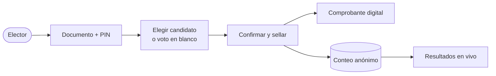

# Plataforma de Votación Electrónica

> Proyecto de votación electrónica local-first, en desarrollo.
> No está certificado para elecciones reales.
> La documentación completa en PDF está en [doc_completa.pdf](docs/doc_completa.pdf) y en Word en [doc_completa.docx](docs/doc_completa.docx).

## 1. Contextualización del Tema

### 1.1 ¿Qué es una Plataforma de Votación Electrónica?
Una plataforma de votación electrónica es un sistema de información diseñado para registrar, procesar, tabular y auditar sufragios de manera digital, ya sea en puestos de votación presenciales (mediante dispositivos de registro directo o DRE) o de forma remota a través de redes seguras.

A nivel global, la adopción del voto electrónico busca mejorar la eficiencia en la tabulación de resultados, reducir el uso de papel, eliminar errores humanos en el escrutinio de mesas y permitir la entrega de resultados preliminares en tiempos reducidos. Países como Estonia han consolidado modelos de voto por internet, mientras que otros como Brasil utilizan urnas electrónicas presenciales con respaldo digital.

### 1.2 Problemática de los Procesos Electorales Tradicionales
Los métodos de votación tradicionales basados en papeletas físicas presentan desafíos recurrentes que impactan la eficiencia y la confianza en los resultados:
* **Errores humanos y lentitud en el escrutinio:** El conteo manual de votos es un proceso dispendioso y propenso a equivocaciones al momento de tabular y diligenciar las actas físicas.
* **Riesgos de custodia e integridad:** El transporte y almacenamiento de material electoral físico implica riesgos de extravío, daño o alteración de votos.
* **Altos costos logísticos:** Requieren una gran inversión de recursos en la impresión de tarjetones, distribución de material y despliegue de personal.
* **Dificultad de auditoría y verificación:** El recuento físico de votos ante controversias o inconsistencias es complejo y demorado, lo que suele generar incertidumbre en los participantes.

### 1.3 El Dilema Central del Voto Digital
En la ingeniería de software, diseñar un sistema electoral representa un reto singular debido a que debe satisfacer dos principios fundamentales:
1. **Secreto del Voto (Anonimato):** Nadie (ni los administradores del sistema, ni los auditores, ni otros votantes) debe poder asociar la identidad de un ciudadano con su elección específica.
2. **Integridad y Verificabilidad (Auditabilidad):** Cada voto emitido debe ser registrado exactamente como el votante lo expresó, sin alteraciones, y debe ser posible auditar que el conteo final corresponde con la totalidad de los votos emitidos.

Adicionalmente, se deben mitigar riesgos como la coerción, el fraude informático, la suplantación de identidad, la denegación de servicio (DoS) y la pérdida de confianza de los participantes.

---

## 2. Objetivos del Proyecto

### 2.1 Objetivo General
Desarrollar un prototipo funcional de una **Plataforma de Votación Electrónica** que permita simular un proceso electoral, facilitando la autenticación de votantes, la emisión anónima del voto, el conteo automatizado de resultados y el registro de auditoría de la jornada.

### 2.2 Objetivos Específicos
1. **Permitir la configuración de la jornada electoral:** Facilitar el registro de los candidatos y opciones de votación necesarios para llevar a cabo el proceso electoral.
2. **Implementar el control de acceso y validación de votantes:** Desarrollar un mecanismo para autenticar a los electores y verificar que solo puedan ejercer su derecho al voto una única vez.
3. **Garantizar el secreto y la privacidad del voto:** Diseñar la lógica de emisión de papeletas digitales de forma que la identidad del usuario no quede vinculada a la opción seleccionada.
4. **Construir el motor de conteo automatizado:** Desarrollar el módulo encargado de registrar, tabular y totalizar los votos emitidos para presentar los resultados del escrutinio de manera precisa.
5. **Crear un registro de eventos y auditoría:** Implementar un sistema de registro cronológico (*logs*) para rastrear eventos clave (apertura de votación, emisión de votos, cierre de jornada y emisión de resultados), permitiendo verificar la transparencia del proceso.

---

## 3. Cómo Funciona la Plataforma

### 3.1 Roles de la plataforma

| Rol | Qué puede hacer |
|---|---|
| **Elector** | Identificarse con documento y PIN, elegir un candidato o el voto en blanco, emitir el voto y recibir un comprobante. |
| **Administrador** | Abrir y cerrar la jornada, gestionar el censo, generar el acta de escrutinio y revisar la auditoría. |
| **Observador** | Consultar los resultados en vivo sin acceder a controles administrativos. |

### 3.2 Recorrido de un voto



En palabras simples:

1. El elector se identifica con su documento y su PIN.
2. El sistema verifica que esté habilitado y que no haya votado antes.
3. Elige un candidato o el voto en blanco.
4. Confirma: el voto se sella y se guarda de forma anónima.
5. Recibe un comprobante y los resultados se actualizan sin revelar por quién votó.

### 3.3 Funcionalidades principales

- **Cabina de votación digital** con autenticación por documento y PIN.
- **Voto para candidato o voto en blanco**, con confirmación y comprobante.
- **Resultados en vivo** con gráficos y porcentajes de participación.
- **Panel administrativo protegido** para abrir y cerrar la jornada, gestionar el censo y el catálogo de candidatos, generar el acta y revisar la auditoría.
- **Acta persistida y descargable** en JSON/CSV; la auditoría se guarda con hash chain y también se exporta.
- **Dos modalidades electorales:** nacional (CNE) y universitaria (UDI).
- **Conmutación de modalidad** sin reiniciar la aplicación.

> Para el recorrido completo con capturas, consulta el [manual de uso](docs/manual_de_uso.md).

---

## 4. Documentación

La plataforma implementa **12 patrones de diseño GoF**, equilibrados por categoría: **4 creacionales, 5 estructurales y 3 de comportamiento**. La documentación se organiza en tres documentos por categoría; cada patrón explica el problema, la solución, su UML, el código y el argumento para conservarlo o descartarlo.

| Documento | Qué aporta | Enlace |
|---|---|---|
| Creacionales | Singleton, Factory Method, Abstract Factory, Builder y el descartado Prototype. | [Abrir](docs/avances/01_creacionales.md) |
| Estructurales | Adapter, Decorator, Facade, Flyweight, Proxy y los descartados Bridge y Composite. | [Abrir](docs/avances/02_estructurales.md) |
| Comportamiento | State, Chain of Responsibility, Observer y los ocho patrones evaluados y no adoptados. | [Abrir](docs/avances/03_comportamiento.md) |

Las decisiones de arquitectura están en [`docs/adr/`](docs/adr/): local-first, selección de los 12 patrones, persistencia de estado/auditoría y catálogo de candidatos.

---

## 5. Ejecución rápida

Desde la raíz del proyecto:

```bash
python3 -m venv venv
source venv/bin/activate
pip install -r requirements.txt
python3 -m src.main
```

La aplicación queda disponible en:

| Módulo | URL | Para qué sirve |
|---|---|---|
| Cabina de votación | [http://127.0.0.1:8000/](http://127.0.0.1:8000/) | Emitir el voto. |
| Resultados en vivo | [http://127.0.0.1:8000/dashboard](http://127.0.0.1:8000/dashboard) | Consultar resultados públicos. |
| Administración | [http://127.0.0.1:8000/admin](http://127.0.0.1:8000/admin) | Panel administrativo; redirige a `/admin/login` si no hay sesión. |
| Documentación de la API | [http://127.0.0.1:8000/docs](http://127.0.0.1:8000/docs) | Probar los endpoints REST. |

No necesitas crear `.env` para ejecutar la aplicación en local.

### Pruebas

```bash
./venv/bin/pytest tests/ -q --cov=src --cov-report=term-missing
```

La suite usa una base separada (`test_e_voting.db`), recrea el entorno antes de
cada prueba y cubre autenticación, voto único, concurrencia, Estado de la
jornada, cadena de validación, auditoría con hash chain, candidatos, acta
persistida y reset.

También hay atajos y CI:

```bash
make install   # crea el venv e instala dependencias
make test      # pytest + cobertura mínima del 80 %
make lint      # Ruff
make run       # servidor local
```

El workflow [`.github/workflows/ci.yml`](.github/workflows/ci.yml) corre lint y
pruebas en cada push o pull request.

**Credenciales de prueba:**

| Rol | Documento / usuario | Clave |
|---|---|---|
| Administrador | `admin` | `admin1234` |
| Elector CNE (CC) | `10203040`, `50607080`, `70809010` | PIN `1234` |
| Elector UDI (ID) | `EST-2024`, `EST-9012`, `EST-3341` | PIN `1234` |

> Para cambiar las variables de `.env` o revisar la configuración, consulta [Configuración y seguridad](docs/configuracion.md).
