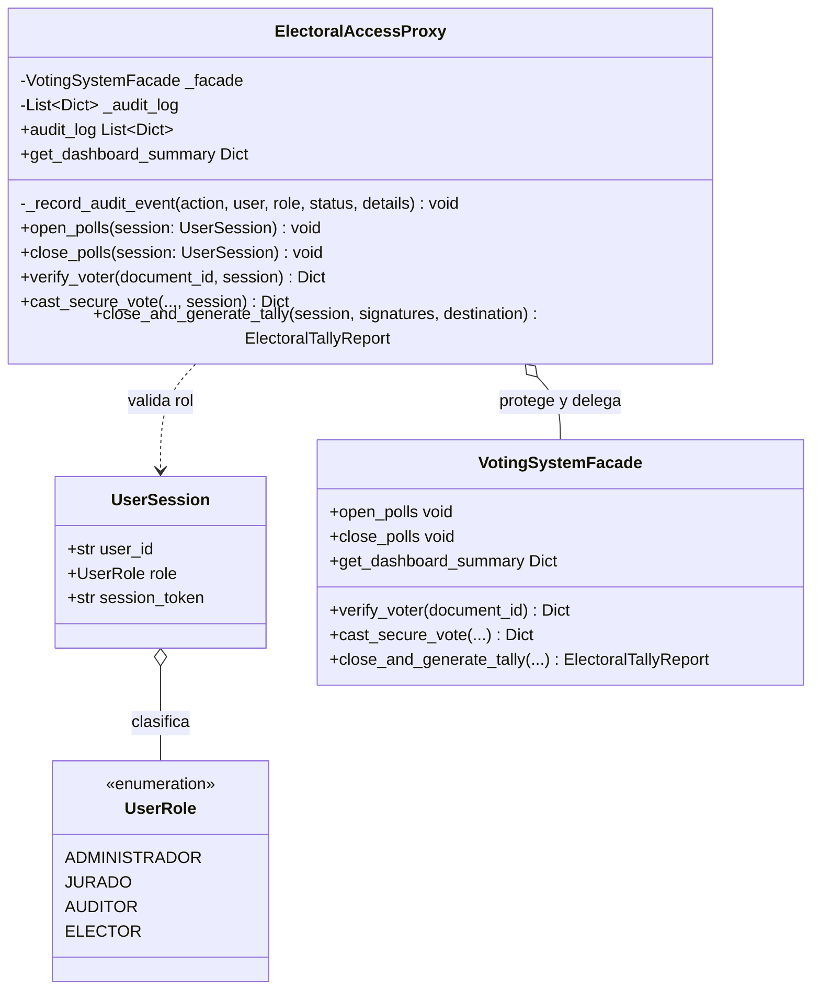
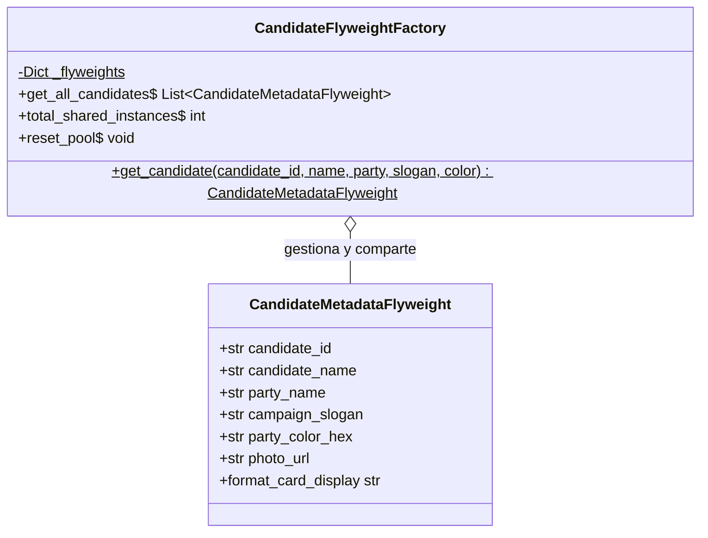

# Patrones de Diseño Proxy y Flyweight

## 1. Identificación del patrón
* **Patrones de Diseño:** Proxy y Flyweight (Patrones Estructurales).
* **Elementos del Sistema:**
  * **Seguridad y Control de Acceso (Proxy):** `ElectoralAccessProxy`, modelo de sesión `UserSession`, y enumeración de roles `UserRole` (`ADMINISTRADOR`, `JURADO`, `AUDITOR`, `ELECTOR`).
  * **Optimización de Opciones Electorales (Flyweight):** `CandidateMetadataFlyweight` (Estado Intrínseco) y pool centralizado `CandidateFlyweightFactory`.
* **Ubicación del Código:**
  * `src/modules/security/access_proxy.py`
  * `src/modules/voting/candidate_flyweight.py`

---

## 2. Justificación y Problema que Resuelven en el Dominio

El sistema aborda dos retos fundamentales de la plataforma: **la seguridad de privilegios** y **la eficiencia de memoria a escala**.

### 2.1 Justificación de PROXY: Control de Privilegios y Auditoría Forense
En un sistema electoral, no todos los usuarios pueden ejecutar cualquier operación:
* Solo los **ADMINISTRADORES** pueden abrir formalmente la jornada electoral o reconfigurar los parámetros de las mesas.
* Solo los **JURADOS DE MESA** o electores autenticados pueden registrar votos en la cabina.
* Solo los **JURADOS y ADMINISTRADORES** debidamente identificados pueden cerrar urnas y firmar el Acta de Escrutinio.
* Los **AUDITORES** tienen acceso de solo lectura para fiscalizar la transmisión de resultados y el estado de las urnas.

**El Problema de Seguridad sin Proxy:**
Si expusiéramos directamente el `VotingSystemFacade` al cliente web o API, tendríamos que ensuciar la lógica de negocio con verificaciones de permisos repetitivas en cada método, violando el Principio de Responsabilidad Única (SRP).

**Solución Proxy:** `ElectoralAccessProxy` envuelve la fachada y actúa como un sustituto o intermediario protector. Intercepta cada solicitud antes de que llegue al núcleo:
1. Verifica si el rol de la sesión cuenta con privilegios legales para la acción solicitada.
2. Registra un evento de auditoría en la bitácora (`_audit_log`), documentando quién, cuándo y con qué resultado se intentó la operación.
3. Si la verificación es exitosa, delega la llamada a `VotingSystemFacade`; si no, bloquea la acción arrojando `PermissionError`.

### 2.2 Justificación de FLYWEIGHT: Eficiencia de Memoria a Escala
En una elección masiva (a nivel universitario con miles de votantes, o a nivel nacional con millones de ciudadanos), cada sufragio emitido por un candidato contiene información descriptiva:
* Nombre completo del candidato.
* Partido político o movimiento ciudadano.
* Lema de campaña.
* Logotipo y color oficial del tarjetón.

**El Problema de Consumo en Memoria:**
Si cada papeleta instanciara sus propias copias de estos textos e imágenes, se repetiría información innecesariamente.

**Solución Flyweight (Separación de Estados):**
* **Estado Intrínseco (Compartido e Inmutable):** Modelado en `CandidateMetadataFlyweight`. Contiene los datos fijos del candidato (`candidate_id`, `candidate_name`, `party_name`, `slogan`, `color`). Este objeto existe **una única vez en memoria por candidato** y se comparte en el catálogo y en la validación server-side. La papeleta persistida guarda el `candidate_id`, no una copia completa de la ficha.
* **Estado Extrínseco (Único por voto):** Modelado en la papeleta individual (`ballot_id`, `issued_at`, `receipt_code`).
* **Criterio contra la sobreingeniería ("Patternitis"):** En lugar de crear jerarquías pesadas innecesarias, se implementó `CandidateFlyweightFactory` de forma compacta y legible (~35 líneas), proporcionando además el catálogo oficial para renderizar el tarjetón visual en la interfaz web.

---

## 3. Parte A: Patrón de Diseño PROXY

### 3.1 Modelo Estructural y Diagrama de Clases (UML)



### 3.2 Implementación Técnica en Código (`src/modules/security/access_proxy.py`)

```python
class ElectoralAccessProxy:
    """Proxy de protección y auditoría sobre VotingSystemFacade."""

    def __init__(self, target_facade: VotingSystemFacade) -> None:
        self._facade = target_facade
        self._audit_log: List[Dict[str, Any]] = []

    def open_polls(self, session: UserSession) -> None:
        """Permite abrir la urna únicamente a usuarios con rol ADMINISTRADOR."""
        if session.role != UserRole.ADMINISTRADOR:
            self._record_audit_event("OPEN_POLLS", session.user_id, session.role.value, "RECHAZADO")
            raise PermissionError("Acceso denegado: Se requiere rol ADMINISTRADOR para abrir la jornada electoral.")

        self._record_audit_event("OPEN_POLLS", session.user_id, session.role.value, "AUTORIZADO")
        self._facade.open_polls

    def close_and_generate_tally(
        self,
        session: UserSession,
        officer_signatures: List[str],
        dispatch_destination: Optional[str] = None,
    ) -> ElectoralTallyReport:
        """Controla el escrutinio final exigiendo firmas de jurados y privilegios."""
        if session.role not in (UserRole.ADMINISTRADOR, UserRole.JURADO):
            self._record_audit_event("GENERATE_TALLY", session.user_id, session.role.value, "RECHAZADO")
            raise PermissionError("Acceso denegado: Solo jurados o administradores pueden consolidar el acta final.")

        report = self._facade.close_and_generate_tally(
            officer_signatures=officer_signatures,
            dispatch_destination=dispatch_destination,
        )
        self._record_audit_event("GENERATE_TALLY", session.user_id, session.role.value, "CONCLUIDO")
        return report
```

---

## 4. Parte B: Patrón de Diseño FLYWEIGHT

### 4.1 Modelo Estructural y Diagrama de Clases (UML)



### 4.2 Implementación Técnica en Código (`src/modules/voting/candidate_flyweight.py`)

```python
@dataclass(frozen=True)
class CandidateMetadataFlyweight:
    """Estado intrínseco e inmutable compartido en el catálogo de candidatos."""
    candidate_id: str
    candidate_name: str
    party_name: str
    campaign_slogan: str
    party_color_hex: str
    photo_url: str

class CandidateFlyweightFactory:
    """Fábrica y almacén común (Pool) para compartir instancias únicas en memoria."""

    _flyweights: Dict[str, CandidateMetadataFlyweight] = {}

    @classmethod
    def get_candidate(cls, candidate_id: str, **kwargs) -> CandidateMetadataFlyweight:
        c_id = str(candidate_id).strip
        if c_id not in cls._flyweights:
            cls._flyweights[c_id] = CandidateMetadataFlyweight(candidate_id=c_id, **kwargs)
        return cls._flyweights[c_id]
```

---

## 5. Análisis de Ingeniería de Software

### 5.1 Cumplimiento de Principios SOLID
* **Single Responsibility Principle (SRP):**
  - `VotingSystemFacade` solo se encarga de la lógica orquestada del dominio electoral.
  - `ElectoralAccessProxy` asume la responsabilidad de validar el rol de la sesión y registrar la auditoría; la emisión de la cookie la realiza `src/presentation/auth.py`.
  - `CandidateFlyweightFactory` se ocupa exclusivamente de mantener el catálogo compartido de candidatos.
* **Open/Closed Principle (OCP):** Es posible incorporar nuevos tipos de proxies (ej. `CachingProxy` para respuestas rápidas de dashboard) o nuevos roles de acceso sin modificar el código interno del Facade.
* **Liskov Substitution Principle (LSP):** El cliente interactúa con el Proxy utilizando las mismas operaciones esperadas del sistema electoral.

### 5.2 Balance arquitectónico
Con la incorporación de **Proxy** y **Flyweight**, el catálogo de patrones estructurales queda implementado con una justificación de dominio sólida:

| # | Patrón Estructural | Módulo | Problema que Resuelve en el Dominio |
|---|---|---|---|
| 1 | **Adapter** | `src/modules/census/` | Homogeneiza censos externos heterogéneos (JSON vs CSV). |
| 2 | **Bridge** | `src/modules/transmission/` | Desacopla boletines de salida de los canales físicos de transporte. |
| 3 | **Composite** | `src/modules/election/` | Jerarquiza el mapa electoral y mesas en estructura parte-todo. |
| 4 | **Decorator** | `src/modules/voting/` | Añade capas dinámicas de seguridad al voto sin explosión de clases. |
| 5 | **Facade** | `src/modules/facade/` | Unifica todos los subsistemas en una interfaz limpia de alto nivel. |
| 6 | **Proxy** | `src/modules/security/` | Protege operaciones sensibles con validación de roles y auditoría. |
| 7 | **Flyweight** | `src/modules/voting/` | Comparte los metadatos de los candidatos y evita copiar la ficha completa en cada papeleta. |