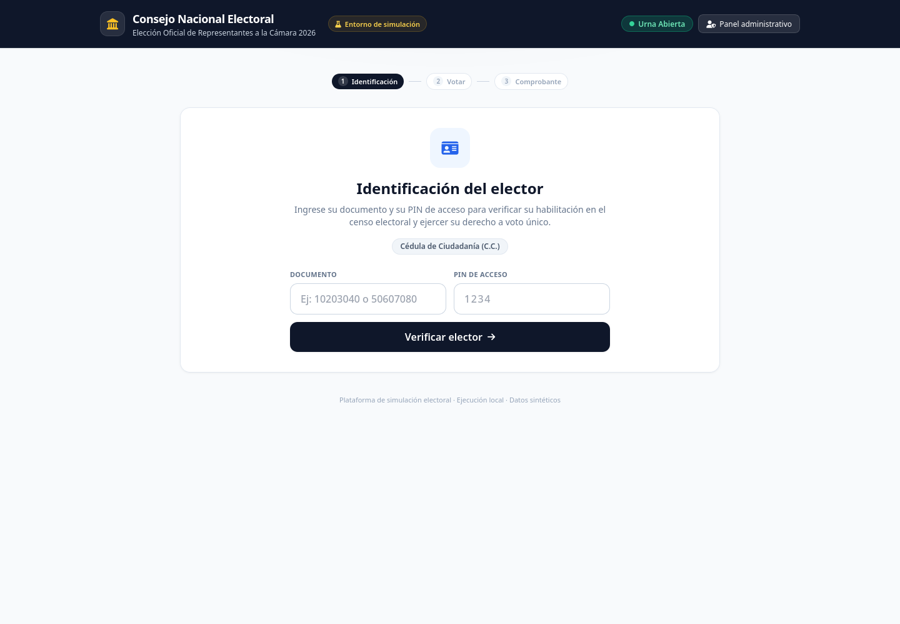
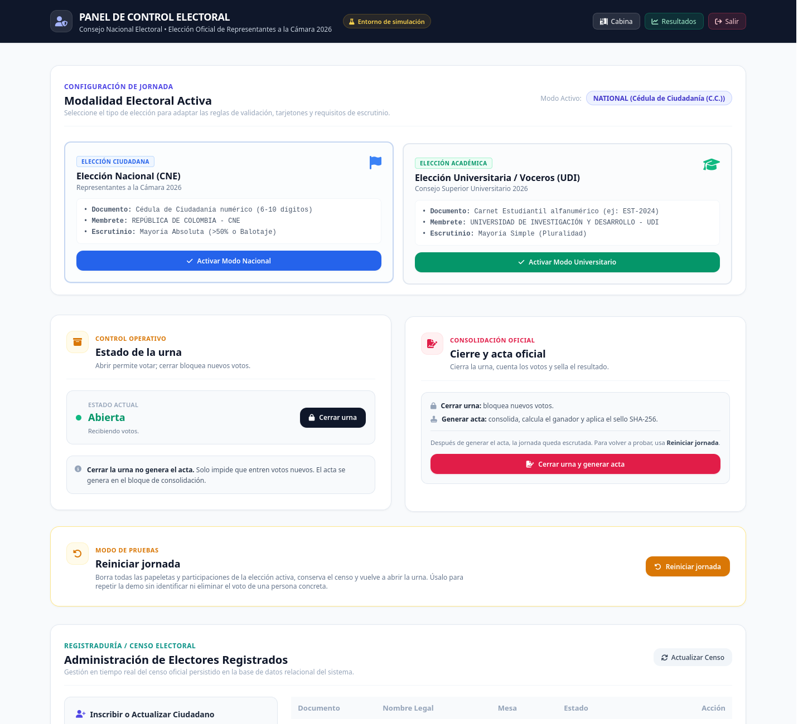

# Manual de uso de la plataforma electoral

> **Entorno:** simulación local con datos sintéticos.
> **Comando oficial:** `python3 -m src.main`
> **Objetivo:** mostrar cómo se usa la plataforma de principio a fin y servir como evidencia de funcionamiento.

---

## 1. Antes de empezar

### Requisitos

- Python 3.12 o superior.
- Entorno virtual activo.
- Dependencias instaladas:

```bash
source venv/bin/activate
pip install -r requirements.txt
```

### Configuración: `.env` y `.env.example`

- `.env.example` es la **plantilla** que se versiona en el repositorio.
- `.env` es tu **configuración real** y está en `.gitignore` (no se sube).
- Para crearla:

```bash
cp .env.example .env
# edita ADMIN_PASSWORD y SECRET_KEY
```

Si borras `.env`, la aplicación arranca con valores locales por defecto. Si borras `.env.example`, puedes recuperarlo desde el repositorio.

### Arranque

Desde la raíz del proyecto:

```bash
python3 -m src.main
```

La aplicación queda disponible en:

| Módulo | URL |
|---|---|
| Cabina de votación | http://127.0.0.1:8000/ |
| Resultados en vivo | http://127.0.0.1:8000/dashboard |
| Acceso administrativo | http://127.0.0.1:8000/admin/login |
| Documentación de la API | http://127.0.0.1:8000/docs |

### Credenciales de demostración

- **Administrador:** usuario `admin` y contraseña definida en `.env` (por defecto `admin1234`).
- **Electores:** todos usan el PIN `1234`.
- **Documentos nacionales:** `10203040`, `50607080`, `70809010`, `80901020`, `20000002`, etc.
- **Documentos universitarios:** `EST-2024`, `EST-9012`, `EST-3341`, `EST-5520`, `EST-1001`, etc.

> El PIN `1234` es una credencial de simulación. No representa un mecanismo de autenticación de nivel electoral.

---

## 2. Recorrido del elector

### 2.1 Identificación

El elector abre la cabina, escribe su documento y su PIN, y pulsa **Verificar elector**.



*Figura 1. Pantalla inicial de la cabina con documento y PIN.*

El sistema valida:

1. Que la jornada esté abierta.
2. Que el formato del documento corresponda a la modalidad.
3. Que el documento exista en el censo y esté habilitado.
4. Que el PIN sea correcto.
5. Que el elector no haya votado ya en esa elección.

Si algo falla, se muestra un mensaje sin revelar si el documento existe o no.

### 2.2 Selección del tarjetón

Una vez verificado, el elector ve el tarjetón oficial con los candidatos y la opción de **Voto en Blanco**.

- Puede seleccionar un candidato o el voto en blanco.
- El botón **Confirmar y emitir sufragio** se habilita solo cuando hay una selección.
- El servidor recibe únicamente el identificador de la opción; el nombre y el partido los resuelve el sistema.

### 2.3 Comprobante

Al confirmar, se muestra un comprobante con:

- Código de recibo.
- Identificador anónimo de la papeleta.
- Sello de tiempo UTC.
- Sello de integridad HMAC-SHA256.

El comprobante no contiene el documento del votante.

### 2.4 Resultados públicos

El enlace **Ver resultados en vivo** lleva al dashboard:

- Estado de la urna.
- Total de sufragios.
- Censo habilitado.
- Porcentaje de participación.
- Desglose por candidato y voto en blanco.

El dashboard se actualiza cada cinco segundos.

---

## 3. Panel administrativo

### 3.1 Acceso

La ruta `/admin` redirige a `/admin/login` si no hay sesión.


*Figura 2. Pantalla de acceso al panel administrativo.*

El acceso usa una única cuenta local. La sesión se guarda en una cookie `HttpOnly`; el JavaScript del panel no ve el valor de la sesión.

### 3.2 ¿Cerrar la urna o generar el acta?

Son dos acciones distintas, aunque el botón principal haga las dos:

| Acción | Qué hace | ¿Se puede deshacer? |
|---|---|---|
| **Cerrar urna** | Bloquea nuevos votos. No cuenta ni sella nada. | Sí: se puede volver a abrir si no se generó acta. |
| **Generar acta** | Cierra la urna, cuenta los votos, calcula el ganador y aplica el sello SHA-256. | No: la jornada queda escrutada; para repetir hay que **Reiniciar jornada**. |

La expresión “aún no finalizar” no aplica aquí: **el acta es la finalización**. Después de generarla, la urna queda cerrada y escrutada; el botón de abrir se desactiva. Si necesitas seguir probando, usa **Reiniciar jornada**, que borra los votos pero conserva el censo.

### 3.2 Funciones disponibles

| Función | Qué hace |
|---|---|
| **Cambiar modalidad** | Alterna entre Elección Nacional y Universitaria. Los votos de cada modalidad se conservan por separado. |
| **Control de urna** | Abre o cierra la jornada. |
| **Cierre y acta** | Cierra la urna, cuenta los votos y genera el acta con sello SHA-256. |
| **Reiniciar jornada** | Borra todas las papeletas y participaciones de la elección activa; **conserva el censo**. |
| **Censo electoral** | Lista, inscribe, actualiza y habilita/inhabilita electores. |
| **Bitácora** | Muestra los eventos de verificación, emisión, apertura, cierre, acta y reset. |



*Figura 3. Panel administrativo con el estado de la urna y las acciones de cierre, acta y reinicio.*

### 3.3 Reiniciar la jornada

El botón **Reiniciar jornada** es la forma correcta de volver a probar el flujo:

- Borra **todos** los votos y participaciones de la elección activa.
- **No** borra el censo.
- **No** permite borrar el voto de una persona concreta, porque eso obligaría a vincular identidad y papeleta.

Para probar con un elector distinto sin borrar la jornada, basta con usar otro documento del censo.

### 3.4 Acta de escrutinio

Al generar el acta, el panel muestra:

- Total de sufragios.
- Votos por opción.
- Votos en blanco.
- Veredicto según la regla de la modalidad.
- Sello SHA-256 del acta.
- Firmas de jurados registradas.

---

## 4. Evidencias de funcionamiento

| Evidencia | Archivo | Qué muestra |
|---|---|---|
| Cabina de votación | `capturas/01_cabina.png` | Identificación con documento + PIN, indicador de pasos y estado de la urna. |
| Acceso administrativo | `capturas/02_admin_login.png` | Protección del panel y cuenta única local. |
| Cabina en móvil | `capturas/03_cabina_movil.png` | Diseño responsive: formulario en una columna y stepper compacto. |
| Panel administrativo | `capturas/04_admin_panel.png` | Estado de urna, cierre, acta, reset y censo con el rediseño. |

> Para completar la evidencia, puedes añadir capturas propias del dashboard y del panel administrativo autenticado en la misma carpeta `capturas/`.

---

## 5. Comandos útiles

```bash
# Reiniciar la base de demostración (borra votos, participaciones y censo)
./venv/bin/python scripts/reset_db.py

# Generar votos de demostración en modo nacional
./venv/bin/python scripts/cast_demo_votes.py

# Generar votos de demostración en modo universitario
ELECTION_MODE=university ./venv/bin/python scripts/cast_demo_votes.py

# Ejecutar pruebas
pytest -q

# Generar hash de contraseña de administrador (opcional)
./venv/bin/python scripts/hash_password.py "mi-clave"
```

---

## 6. Solución de problemas

| Síntoma | Causa probable | Solución |
|---|---|---|
| La página no carga | El servidor no está corriendo | Ejecutar `python3 -m src.main` desde la raíz. |
| `ModuleNotFoundError: src` | Se ejecutó `python src/main.py` | Usar `python3 -m src.main`. |
| El elector no puede votar | PIN incorrecto, documento inhabilitado o ya votó | Revisar el censo en el panel; usar otro documento o reiniciar la jornada. |
| El panel redirige al login | Sesión vencida o cookie eliminada | Volver a iniciar sesión. |
| El dashboard muestra 0 votos | La jornada se reinició o no hay votos | Emitir votos de prueba o ejecutar el script de demostración. |
| Error de base de datos bloqueada | Demasiadas escrituras simultáneas en SQLite | Reintentar; para producción se recomienda PostgreSQL. |

---

## 7. Alcance y límites

Esta plataforma es un **simulador local**:

- Usa datos sintéticos.
- La autenticación del elector es básica (documento + PIN de demostración).
- El sello HMAC sirve para aprender integridad, pero no es una firma digital asimétrica.
- La bitácora vive en memoria y se reinicia con el proceso.
- No está certificada para elecciones reales.

Estas limitaciones están documentadas para que la demostración sea honesta y para dejar claro qué se necesitaría antes de un despliegue real.
