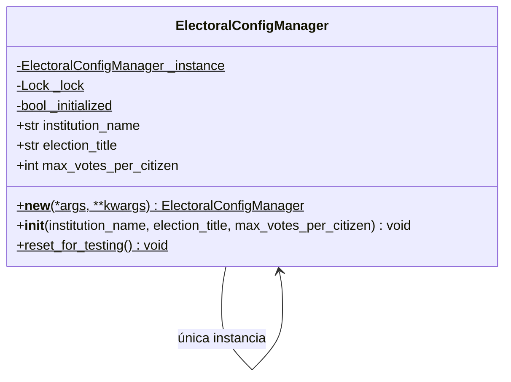
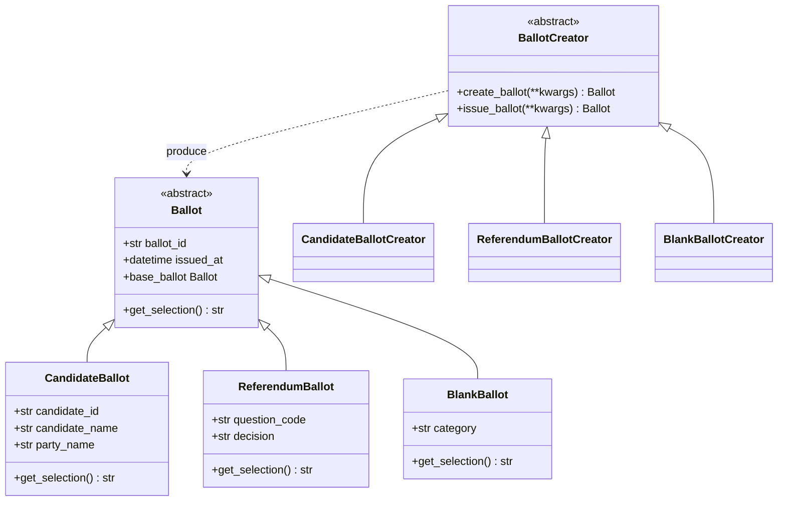
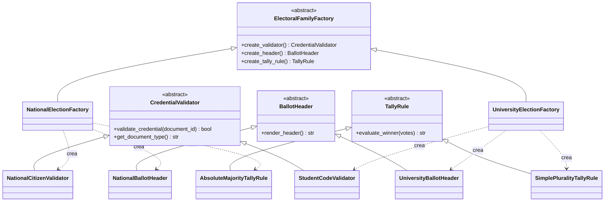
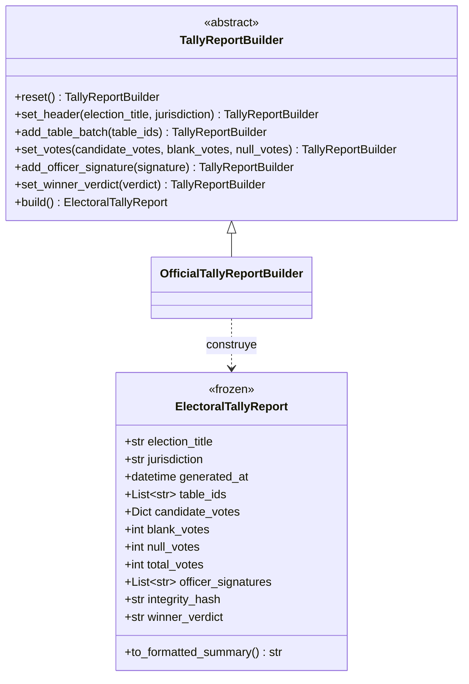

# Patrones creacionales

> Esta parte del documento técnico cubre la categoría **creacional** del catálogo GoF.
> Específicamente los cinco patrones: Singleton, Factory Method, Abstract Factory, Builder
> y Prototype. Los cuatro primeros están implementados; el último se evaluó y se
> retiró. Cada sección conserva el mismo formato: identificación, problema,
> estructura, implementación, análisis, pruebas y límites.

## Ficha de la categoría

| Aspecto | Descripción |
|---|---|
| Categoría | Creacional |
| Pregunta que responde | ¿Cómo se crean los objetos sin acoplar el cliente a sus clases concretas? |
| Patrones implementados | Singleton, Factory Method, Abstract Factory, Builder |
| Patrón descartado | Prototype |
| Archivos principales | `src/core/config.py`, `src/modules/voting/ballot_factory.py`, `src/modules/election/election_factory.py`, `src/modules/tally/report_builder.py` |
| Evidencia | `tests/unit/test_factories_and_ballots.py`, `tests/integration/test_admin_flow.py`, `tests/integration/test_candidates_and_tally.py` |

## Contenido

1. [Singleton](#1-singleton)
2. [Factory Method](#2-factory-method)
3. [Abstract Factory](#3-abstract-factory)
4. [Builder](#4-builder)
5. [Prototype (evaluado y descartado)](#5-prototype-evaluado-y-descartado)
6. [Conclusión de la categoría](#6-conclusión-de-la-categoría)

## Matriz de decisión

| Patrón | ¿Se usa? | Dónde | Decisión |
|---|---|---|---|
| **Singleton** | Sí | `src/core/config.py` | Mantener como configuración única de la jornada. |
| **Factory Method** | Sí | `src/modules/voting/ballot_factory.py` | Mantener: tipos de papeleta desacoplados. |
| **Abstract Factory** | Sí | `src/modules/election/election_factory.py` | Mantener: familia nacional/universitaria coherente. |
| **Builder** | Sí | `src/modules/tally/report_builder.py` | Mantener: acta compleja construida por pasos. |
| **Prototype** | No | — | Descartar: solo dos mesas fijas, sin plantillas administrables. |

---

# 1. Singleton

## 1.1 Identificación

| Campo | Valor |
|---|---|
| Patrón | Singleton |
| Categoría | Creacional |
| Elemento | `ElectoralConfigManager` |
| Archivo | [`src/core/config.py`](../../src/core/config.py) |
| Intención GoF | Garantizar una única instancia y proporcionar un punto de acceso global. |
| Referencia | Gamma, Helm, Johnson & Vlissides (1994), *Design Patterns*, p. 127. |

## 1.2 Problema y fuerzas del dominio

La jornada electoral tiene datos que deben ser idénticos para todos los módulos:
el nombre de la institución, el título oficial y el límite de votos por ciudadano.
Si la cabina, el panel y el conteo construyeran copias independientes, podrían
mostrar títulos distintos o aplicar límites diferentes.

El sistema también necesita **reconstruir** esa configuración cuando el
administrador cambia entre elección nacional y universitaria. Esa operación no
puede dejar instancias viejas vivas dentro del mismo proceso.

Es importante distinguir dos cosas:

- **Configuración estática:** institución, título y límite. Vive en el Singleton.
- **Estado dinámico de la urna:** abierta, cerrada o escrutada. Vive en
  `ElectionStateMachine` y se persiste en `election_state`.

Esa separación evita que el Singleton se convierta en un almacén global de todo
el estado del sistema.

## 1.3 Modelo estructural



**Participantes.**

| Rol | Elemento | Responsabilidad |
|---|---|---|
| Singleton | `ElectoralConfigManager` | Controla la creación y expone la configuración. |
| Cliente | Fachada, servicios, `main.py` | Consume la misma instancia sin crearla por su cuenta. |

## 1.4 Implementación

```python
class ElectoralConfigManager:
    _instance: Optional["ElectoralConfigManager"] = None
    _lock: threading.Lock = threading.Lock()
    _initialized: bool = False

    def __new__(cls, *args, **kwargs) -> "ElectoralConfigManager":
        if cls._instance is None:
            with cls._lock:
                if cls._instance is None:
                    cls._instance = super().__new__(cls)
        return cls._instance

    def __init__(
        self,
        institution_name: str = "Consejo Nacional Electoral",
        election_title: str = "Elecciones Generales",
        max_votes_per_citizen: int = 1,
    ) -> None:
        if self._initialized:
            return
        with self._lock:
            if not self._initialized:
                self.institution_name = institution_name
                self.election_title = election_title
                self.max_votes_per_citizen = max_votes_per_citizen
                self._initialized = True
```

La implementación usa **doble comprobación con bloqueo**:

1. Se comprueba `_instance` sin adquirir el cerrojo, para no pagar sincronización
   en cada acceso.
2. Si es nula, se entra al bloqueo y se vuelve a comprobar.
3. `_initialized` impide que una segunda llamada a `__init__` sobrescriba los
   datos de la jornada.

`reset_for_testing()` permite reconstruir la instancia cuando se cambia de
modalidad o cuando una prueba necesita un estado limpio.

## 1.5 Análisis de ingeniería

**SRP.** La clase solo custodia la configuración estática. No abre urnas, no
cuenta votos y no guarda papeletas.

**Thread-safety.** El bloqueo evita dos instancias simultáneas en el arranque.
No convierte el objeto en un almacén distribuido: sigue siendo una instancia por
proceso.

**Testabilidad.** `reset_for_testing()` es una concesión deliberada. En producción
se preferiría inyección de dependencias; en esta etapa permite reconstruir el
ecosistema sin reiniciar el proceso.

**Alternativa descartada.** Un módulo de configuración con funciones globales
habría sido más simple, pero perdía el control explícito de una única instancia y
el punto de extensión para la reconstrucción.

## 1.6 Pruebas y límites

- La suite completa ejercita la configuración a través de la fachada.
- `tests/conftest.py` reconstruye el sistema antes de cada prueba, lo que verifica
  que el Singleton no arrastre datos entre escenarios.
- El estado de la urna tiene pruebas propias en
  `tests/unit/test_state_machine.py`.

**Límite honesto.** Con varios workers de Uvicorn habría una instancia por
proceso. Para un despliegue real, la configuración debería venir de variables de
entorno inyectadas o de un almacén compartido, no de un singleton en memoria.

## 1.7 Preguntas de revisión de diseño

**¿Por qué no guardar también `is_open` aquí?**
Porque el estado de la urna cambia con cada operación y debe persistir. Mezclarlo
con la configuración estática fue el problema que se corrigió al introducir State.

**¿Singleton no es un antipatrón?**
Puede serlo cuando se usa como cajón de sastre. Aquí tiene un alcance acotado:
tres datos de configuración y una operación de reconstrucción controlada.

---

# 2. Factory Method

## 2.1 Identificación

| Campo | Valor |
|---|---|
| Patrón | Factory Method |
| Categoría | Creacional |
| Elementos | `Ballot`, `CandidateBallot`, `BlankBallot`, `ReferendumBallot`, `BallotCreator` |
| Archivo | [`src/modules/voting/ballot_factory.py`](../../src/modules/voting/ballot_factory.py) |
| Intención GoF | Definir una interfaz para crear un objeto, dejando a las subclases decidir qué clase instanciar. |
| Referencia | Gamma et al. (1994), p. 107. |

## 2.2 Problema y fuerzas del dominio

La plataforma maneja varios tipos de sufragio:

1. **Candidato nominal:** nombre, partido y `candidate_id`.
2. **Voto en blanco:** opción válida y escrutada.
3. **Referéndum:** pregunta y decisión.

Si `VoteService` construyera cada producto con `if/elif`, cada tipo nuevo
obligaría a modificar el servicio y a repetir validaciones. El conteo también
tendría que conocer las diferencias entre productos.

## 2.3 Modelo estructural



**Participantes.**

| Rol | Elemento | Responsabilidad |
|---|---|---|
| Producto | `Ballot` | Contrato común: identificador, fecha y selección legible. |
| Productos concretos | `CandidateBallot`, `BlankBallot`, `ReferendumBallot` | Representan cada tipo de sufragio. |
| Creador | `BallotCreator` | Declara `create_ballot` y ofrece `issue_ballot`. |
| Creadores concretos | `CandidateBallotCreator`, etc. | Deciden qué producto construir. |
| Cliente | `VoteService` | Usa la abstracción, no las clases concretas. |

## 2.4 Implementación

```python
@dataclass(frozen=True)
class Ballot(ABC):
    ballot_id: str
    issued_at: datetime

    @abstractmethod
    def get_selection(self) -> str:
        ...

class BallotCreator(ABC):
    @abstractmethod
    def create_ballot(self, **kwargs) -> Ballot:
        ...

    def issue_ballot(self, **kwargs) -> Ballot:
        return self.create_ballot(**kwargs)

class CandidateBallotCreator(BallotCreator):
    def create_ballot(self, **kwargs) -> CandidateBallot:
        return CandidateBallot(
            ballot_id=str(uuid.uuid4()),
            issued_at=datetime.now(timezone.utc),
            candidate_id=kwargs["candidate_id"],
            candidate_name=kwargs["candidate_name"],
            party_name=kwargs.get("party_name", "Independiente"),
        )
```

`issue_ballot` es la operación de negocio estable; `create_ballot` es el punto de
extensión. Añadir un tipo nuevo implica un producto y un creador, no un `if` en
el servicio de voto.

## 2.5 Análisis de ingeniería

**OCP.** El servicio de voto no cambia cuando aparece un producto nuevo, siempre
que respete el contrato `Ballot`.

**Inmutabilidad.** Los productos son `dataclass(frozen=True)`. Una papeleta no se
modifica después de emitida; los sellos se agregan por composición (Decorator).

**Separación de responsabilidades.** El creador no valida al elector, no persiste
y no decide la seguridad. Eso corresponde a `VoteService` y a los decoradores.

**Alternativa descartada.** Una función `crear_papeleta(tipo, **kwargs)` con
`match/case` sería más corta hoy, pero concentraría todos los tipos y sus
parámetros en un solo punto de cambio.

## 2.6 Pruebas y límites

- `tests/unit/test_factories_and_ballots.py::test_ballot_creators_and_decorators`
  verifica los tres productos y su integración con Decorator.
- `tests/integration/test_voting_flow.py` cubre la emisión real de candidato y
  blanco.

**Límite honesto.** `ReferendumBallot` existe en el dominio y en la API, pero la
cabina no ofrece una pantalla de referendo. Es un punto de extensión, no una
funcionalidad terminada.

## 2.7 Preguntas de revisión de diseño

**¿Por qué no usar simplemente un `if`?**
Con dos tipos sería aceptable. Con tres y con posibilidades de crecer, el `if`
termina en el servicio de voto y en el conteo. El patrón deja un único punto de
extensión.

**¿Factory Method crea familias?**
No. Crea un producto mediante herencia de creadores. Las familias son
responsabilidad de Abstract Factory.

---

# 3. Abstract Factory

## 3.1 Identificación

| Campo | Valor |
|---|---|
| Patrón | Abstract Factory |
| Categoría | Creacional |
| Elementos | `ElectoralFamilyFactory`, `NationalElectionFactory`, `UniversityElectionFactory` |
| Archivo | [`src/modules/election/election_factory.py`](../../src/modules/election/election_factory.py) |
| Intención GoF | Proporcionar una interfaz para crear familias de objetos relacionados sin especificar sus clases concretas. |
| Referencia | Gamma et al. (1994), p. 87. |

## 3.2 Problema y fuerzas del dominio

Una elección nacional y una universitaria no solo cambian el título:

- cambia el documento válido (cédula vs. carnet),
- cambia el encabezado oficial,
- cambia la regla de escrutinio (mayoría absoluta vs. mayoría simple).

Si la fachada combinara piezas manualmente, podría validar una cédula con un
encabezado universitario o aplicar una regla de mayoría simple a una elección
nacional. El sistema quedaría incoherente sin lanzar un error evidente.

## 3.3 Modelo estructural



**Participantes.**

| Rol | Elemento | Responsabilidad |
|---|---|---|
| Fábrica abstracta | `ElectoralFamilyFactory` | Declara los tres productos de la familia. |
| Fábricas concretas | `NationalElectionFactory`, `UniversityElectionFactory` | Garantizan coherencia entre productos. |
| Productos abstractos | `CredentialValidator`, `BallotHeader`, `TallyRule` | Contratos estables. |
| Productos concretos | Validadores, encabezados y reglas | Implementaciones por modalidad. |
| Cliente | `VotingSystemFacade` | Pide productos sin conocer las clases concretas. |

## 3.4 Implementación

```python
class ElectoralFamilyFactory(ABC):
    @abstractmethod
    def create_validator(self) -> CredentialValidator: ...

    @abstractmethod
    def create_header(self) -> BallotHeader: ...

    @abstractmethod
    def create_tally_rule(self) -> TallyRule: ...

class NationalElectionFactory(ElectoralFamilyFactory):
    def create_validator(self) -> CredentialValidator:
        return NationalCitizenValidator()

    def create_header(self) -> BallotHeader:
        return NationalBallotHeader()

    def create_tally_rule(self) -> TallyRule:
        return AbsoluteMajorityTallyRule()
```

La fachada no decide qué validador usar: pide `create_validator()`. Al cambiar de
modalidad, `main.py` reconstruye la fachada con la fábrica correspondiente y
vuelve a cargar el catálogo de candidatos.

## 3.5 Análisis de ingeniería

**Coherencia de familia.** Las tres piezas cambian juntas. No hay forma de mezclar
una cédula con un encabezado universitario si se usa la misma fábrica.

**OCP.** Agregar una tercera modalidad (por ejemplo, municipal) implica una nueva
fábrica y sus productos; la fachada no cambia.

**Relación con Factory Method.** Factory Method crea **un** producto. Abstract
Factory crea **una familia** de productos relacionados. La confusión es frecuente
en revisión de diseño; la diferencia es el alcance.

**Alternativa descartada.** Un objeto de configuración con `if mode == ...` sería
más corto para dos modalidades, pero repartiría la coherencia en condicionales.

## 3.6 Pruebas y límites

- `tests/unit/test_factories_and_ballots.py::test_abstract_factory_families`
  verifica que cada familia produzca validador, encabezado y regla coherentes.
- `tests/integration/test_admin_flow.py::test_abstract_factory_mode_switching`
  conmuta a universidad, vota y escruta con la regla de mayoría simple.

**Límite honesto.** Con solo dos familias, Abstract Factory es discutible. Se
mantiene porque las piezas son reales y cambian juntas; si el dominio se quedara
en una sola modalidad, sobraría.

## 3.7 Preguntas de revisión de diseño

**¿Abstract Factory no es sobreingeniería para dos modalidades?**
Podría serlo si solo cambiara el título. Aquí cambian documento, encabezado y
regla; la fábrica evita combinaciones inválidas.

**¿Dónde se elige la familia?**
En el composition root (`src/main.py`), no en la API ni en el frontend.

---

# 4. Builder

## 4.1 Identificación

| Campo | Valor |
|---|---|
| Patrón | Builder |
| Categoría | Creacional |
| Elementos | `TallyReportBuilder`, `OfficialTallyReportBuilder`, `ElectoralTallyReport` |
| Archivo | [`src/modules/tally/report_builder.py`](../../src/modules/tally/report_builder.py) |
| Intención GoF | Separar la construcción de un objeto complejo de su representación, para que el mismo proceso cree distintas representaciones. |
| Referencia | Gamma et al. (1994), p. 97. |

## 4.2 Problema y fuerzas del dominio

El acta de escrutinio no es un objeto simple. Contiene:

- título y jurisdicción,
- mesas escrutadas,
- votos por candidato,
- votos en blanco y nulos,
- total de sufragios,
- firmas de jurados,
- veredicto según la regla de la modalidad,
- sello SHA-256 de integridad.

Un constructor con diez parámetros sería fácil de usar mal: invertir dos
argumentos, olvidar una firma o calcular el total antes de tiempo. El Builder
hace explícito el orden y concentra la validación final.

## 4.3 Modelo estructural



**Participantes.**

| Rol | Elemento | Responsabilidad |
|---|---|---|
| Producto | `ElectoralTallyReport` | Acta inmutable con sello y resumen. |
| Builder abstracto | `TallyReportBuilder` | Declara los pasos encadenables. |
| Builder concreto | `OfficialTallyReportBuilder` | Acumula estado, valida y calcula el hash. |
| Director | `TallyService` | Decide el orden real del flujo de escrutinio. |
| Cliente | API / panel | Recibe el acta ya construida. |

## 4.4 Implementación

```python
class OfficialTallyReportBuilder(TallyReportBuilder):
    def reset(self) -> "OfficialTallyReportBuilder":
        self._candidate_votes = {}
        self._blank_votes = 0
        self._null_votes = 0
        self._officer_signatures = []
        return self

    def set_header(self, election_title: str, jurisdiction: str) -> "OfficialTallyReportBuilder":
        self._election_title = election_title
        self._jurisdiction = jurisdiction
        return self

    def build(self) -> ElectoralTallyReport:
        total = sum(self._candidate_votes.values()) + self._blank_votes + self._null_votes
        payload = json.dumps(
            {
                "title": self._election_title,
                "jurisdiction": self._jurisdiction,
                "tables": self._table_ids,
                "votes": self._candidate_votes,
                "blank": self._blank_votes,
                "null": self._null_votes,
                "signatures": self._officer_signatures,
                "verdict": self._winner_verdict,
            },
            sort_keys=True,
        )
        digest = hashlib.sha256(payload.encode("utf-8")).hexdigest()
        return ElectoralTallyReport(..., integrity_hash=digest)
```

`TallyService` es el director: cuenta las papeletas, pide la regla a la familia
electoral, encadena los pasos y persiste el acta en `tally_reports` antes de
marcar la jornada como `TALLIED`.

## 4.5 Análisis de ingeniería

**Inmutabilidad.** El producto es `frozen=True`; una vez construido, no se puede
alterar el acta. El hash se calcula sobre el contenido canónico.

**Integridad.** SHA-256 detecta alteraciones del payload, pero no es una firma
asimétrica: no aporta no repudio. Esa diferencia se documenta en los límites.

**SRP.** El builder sabe construir el acta; el servicio sabe cuándo construirla y
qué votos contar; la API solo la presenta.

**Alternativa descartada.** Un constructor con muchos parámetros o un `dict`
suelto habría perdido el orden, la validación y el sello calculado al final.

## 4.6 Pruebas y límites

- `tests/integration/test_admin_flow.py::test_tally_builder_and_proxy_audit`
  verifica longitud del hash, firmas y total.
- `tests/integration/test_candidates_and_tally.py::test_tally_is_persisted_and_exportable`
  verifica que el acta quede en `tally_reports` y se pueda descargar.

**Límite honesto.** El acta se persiste y se exporta en JSON/CSV; el PDF oficial
y la firma asimétrica siguen como trabajo futuro. El hash actual es de
integridad, no de no repudio.

## 4.7 Preguntas de revisión de diseño

**¿Builder no es solo un constructor largo?**
No. El valor está en el proceso por etapas, el estado parcial controlado y el
sellado final. Un constructor de diez parámetros no ofrece nada de eso.

**¿Dónde se guarda el acta?**
En `tally_reports`; la jornada solo pasa a `TALLIED` después de persistirla.

---

# 5. Prototype (evaluado y descartado)

## 5.1 Identificación

| Campo | Valor |
|---|---|
| Patrón | Prototype |
| Categoría | Creacional |
| Uso anterior | `VotingStation` y `StationPrototypeRegistry` |
| Estado | Retirado |
| Intención GoF | Crear objetos nuevos clonando un prototipo existente. |

## 5.2 Qué resolvía

El arranque creaba dos mesas (`MESA-01`, `MESA-02`) a partir de una plantilla.
Prototype formalizaba la clonación profunda y evitaba compartir listas mutables
entre mesas.

## 5.3 Por qué se descartó

- La aplicación solo crea dos mesas fijas.
- No existe una interfaz para que el administrador defina plantillas.
- Una lista `station_ids` en el bootstrap es más corta y más fácil de leer.
- El patrón añadía una jerarquía y un registro de prototipos para un caso que no
  tenía variación real.

## 5.4 Qué se conservó

`station_ids` sigue siendo parte de la configuración de la jornada.
`assigned_station_id` sigue en el censo. No se perdió funcionalidad; se eliminó
indirección.

## 5.5 Condición para volver

Prototype se justificaría si el administrador pudiera crear plantillas de mesa
desde el panel, si hubiera decenas de mesas o si las plantillas tuvieran objetos
complejos que no conviene reconstruir.

---

# 6. Conclusión de la categoría

Los cuatro patrones creacionales que se conservan resuelven problemas distintos:

- **Singleton** centraliza la configuración estática.
- **Factory Method** desacopla la creación de papeletas.
- **Abstract Factory** mantiene coherente una familia electoral.
- **Builder** construye y sella un acta compleja.

Prototype no pagaba su costo en este dominio. La decisión no es “usar todos los
patrones”, sino usar los que resuelven un problema verificable. La matriz de
decisión y los límites de cada sección son la evidencia de ese criterio.
