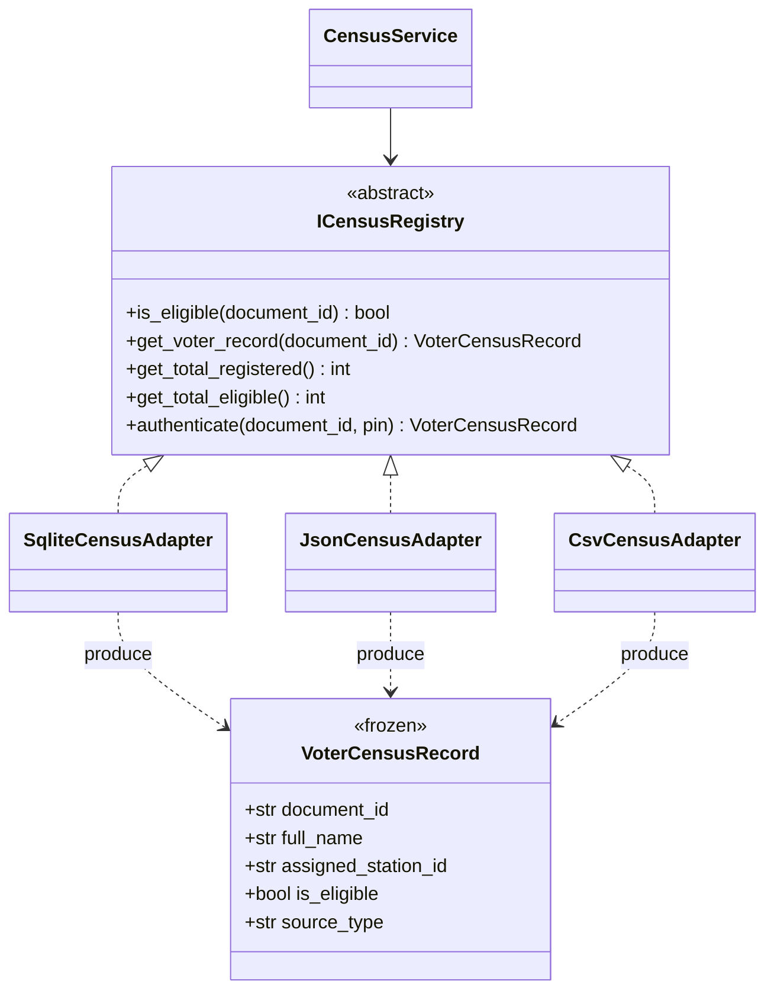
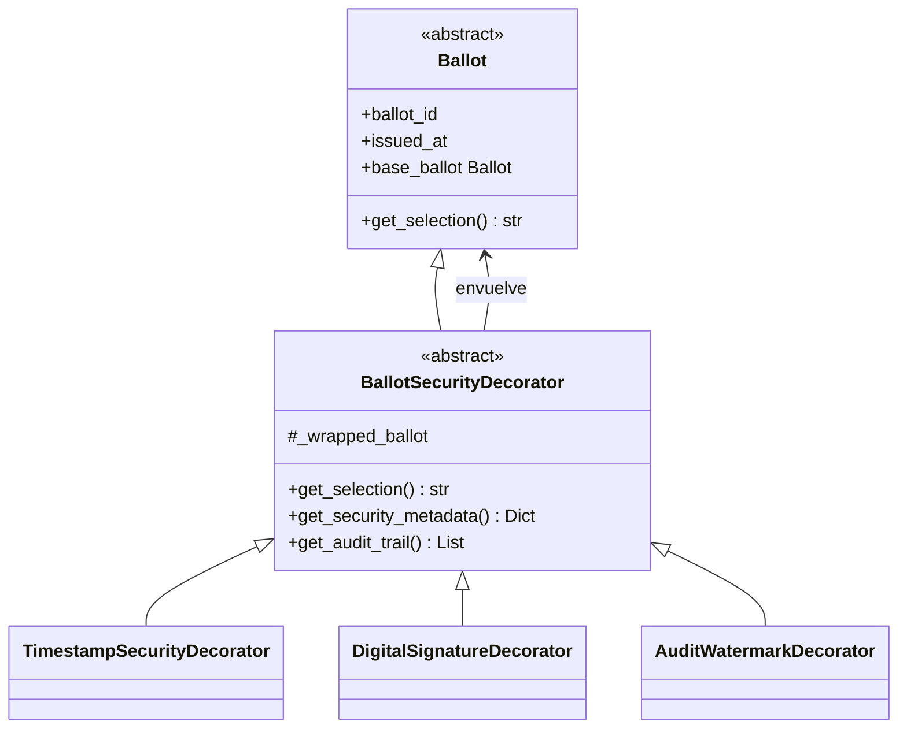
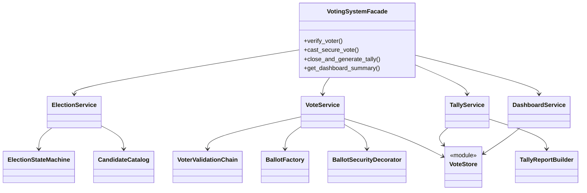
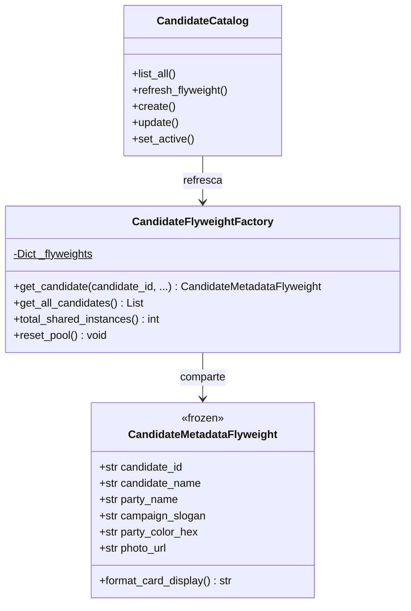
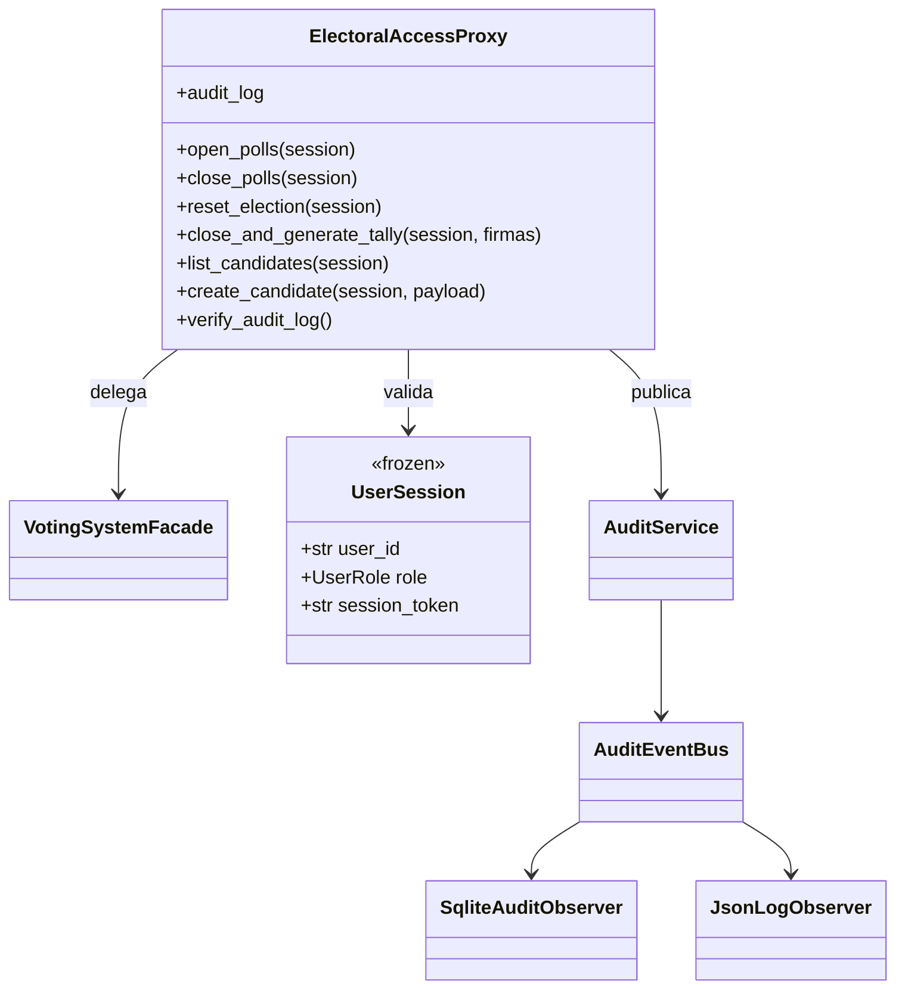

# Patrones estructurales

> Documento técnico de la categoría **estructural** del catálogo GoF.
> Cubre los siete patrones: Adapter, Bridge, Composite, Decorator, Facade,
> Flyweight y Proxy. La aplicación usa cinco; Bridge y Composite se evaluaron y
> se retiraron. Cada sección conserva el formato de identificación, problema,
> estructura, implementación, análisis, pruebas y límites.

## Ficha de la categoría

| Aspecto | Descripción |
|---|---|
| Categoría | Estructural |
| Pregunta que responde | ¿Cómo se componen objetos y clases para formar estructuras más grandes sin acoplarlas? |
| Patrones implementados | Adapter, Decorator, Facade, Flyweight, Proxy |
| Patrones descartados | Bridge, Composite |
| Archivos principales | `src/modules/census/`, `src/modules/voting/ballot_decorator.py`, `src/modules/facade/`, `src/modules/security/` |
| Evidencia | `tests/unit/test_adapters.py`, `tests/integration/test_voting_flow.py`, `tests/integration/test_admin_flow.py`, `tests/integration/test_candidates_and_tally.py` |

## Contenido

1. [Adapter](#1-adapter)
2. [Decorator](#2-decorator)
3. [Facade](#3-facade)
4. [Flyweight](#4-flyweight)
5. [Proxy](#5-proxy)
6. [Bridge (evaluado y descartado)](#6-bridge-evaluado-y-descartado)
7. [Composite (evaluado y descartado)](#7-composite-evaluado-y-descartado)
8. [Conclusión de la categoría](#8-conclusión-de-la-categoría)

## Matriz de decisión

| Patrón | ¿Se usa? | Dónde | Decisión |
|---|---|---|---|
| **Adapter** | Sí | `src/modules/census/` | Mantener: censo SQLite/JSON/CSV bajo un contrato. |
| **Decorator** | Sí | `src/modules/voting/ballot_decorator.py` | Mantener: sellos del voto sin explosión de clases. |
| **Facade** | Sí | `src/modules/facade/` | Mantener: una entrada, servicios pequeños detrás. |
| **Flyweight** | Sí | `src/modules/voting/candidate_flyweight.py` | Mantener: catálogo compartido de candidatos. |
| **Proxy** | Sí | `src/modules/security/access_proxy.py` | Mantener: control de acceso y auditoría. |
| **Bridge** | No | — | Descartar: un solo canal real. |
| **Composite** | No | — | Descartar: sin resultados por mesa. |

---

# 1. Adapter

## 1.1 Identificación

| Campo | Valor |
|---|---|
| Patrón | Adapter |
| Categoría | Estructural |
| Elementos | `ICensusRegistry`, `VoterCensusRecord`, `SqliteCensusAdapter`, `JsonCensusAdapter`, `CsvCensusAdapter` |
| Archivos | [`src/modules/census/contracts.py`](../../src/modules/census/contracts.py), [`sqlite_census.py`](../../src/modules/census/sqlite_census.py), [`json_census.py`](../../src/modules/census/json_census.py), [`csv_census.py`](../../src/modules/census/csv_census.py) |
| Intención GoF | Convertir la interfaz de una clase en otra que el cliente espera. |
| Referencia | Gamma et al. (1994), p. 139. |

## 1.2 Problema y fuerzas del dominio

El censo puede provenir de fuentes heterogéneas:

- una tabla SQLite local (la fuente activa),
- un JSON exportado por una institución,
- un CSV de una registraduría o de Excel.

Si la cabina conociera cada formato, el flujo de autenticación se llenaría de
casos especiales. Además, el dominio quedaría acoplado a SQLAlchemy y a los
nombres de columnas de cada archivo.

El sistema necesita un **contrato estable** para preguntar: ¿existe?, ¿está
habilitado?, ¿cuántos electores hay?, ¿documento + PIN son válidos?

## 1.3 Modelo estructural



**Participantes.**

| Rol | Elemento | Responsabilidad |
|---|---|---|
| Target | `ICensusRegistry` | Contrato que consume el dominio. |
| Adaptee | Tabla SQLite, JSON o CSV | Fuente con su propio formato. |
| Adapter | `SqliteCensusAdapter`, `JsonCensusAdapter`, `CsvCensusAdapter` | Traducen la fuente al contrato. |
| DTO canónico | `VoterCensusRecord` | Ficha inmutable que circula por el dominio. |
| Cliente | `VoteService`, `CensusService`, dashboard | Usan el contrato, no la fuente. |

## 1.4 Implementación

```python
class ICensusRegistry(ABC):
    @abstractmethod
    def authenticate(self, document_id: str, pin: str) -> Optional[VoterCensusRecord]: ...

class SqliteCensusAdapter(ICensusRegistry):
    def authenticate(self, document_id: str, pin: str) -> Optional[VoterCensusRecord]:
        session = SessionLocal()
        try:
            citizen = self._find(session, document_id)
            if not citizen or not citizen.is_eligible:
                return None
            if not verify_pin(pin, citizen.pin_hash):
                return None
            return self._to_record(citizen)
        finally:
            session.close()
```

Los adaptadores JSON y CSV **no autentican**: no traen PIN verificable y fallan
cerrado devolviendo `None`. SQLite es la fuente que implementa credenciales.

## 1.5 Análisis de ingeniería

**DIP.** El dominio depende de `ICensusRegistry`, no de SQLAlchemy. La fuente se
puede cambiar sin tocar la cabina.

**SRP.** Cada adaptador traduce un formato. `CensusService` coordina la
administración del censo; no mezcla lectura con el flujo de voto.

**Testabilidad.** `CsvCensusAdapter` y `JsonCensusAdapter` permiten probar la
normalización sin base de datos.

**Diferencia con Bridge.** Adapter traduce una interfaz incompatible; Bridge
separa dos jerarquías que varían de forma independiente. Ver la sección de
Bridge descartado.

## 1.6 Pruebas y límites

- `tests/unit/test_adapters.py::test_csv_adapter_still_works` cubre CSV y JSON.
- `tests/unit/test_adapters.py::test_sqlite_census_adapter_direct` cubre
  autenticación, alta y habilitación en SQLite.
- `tests/integration/test_census_and_dashboard.py` cubre el censo desde la API.

**Límite.** Hay un solo adaptador real (SQLite). JSON y CSV son
alternativas de integración y prueba; no se presentan como producción.

# 2. Decorator

## 2.1 Identificación

| Campo | Valor |
|---|---|
| Patrón | Decorator |
| Categoría | Estructural |
| Elementos | `BallotSecurityDecorator`, `TimestampSecurityDecorator`, `DigitalSignatureDecorator`, `AuditWatermarkDecorator` |
| Archivo | [`src/modules/voting/ballot_decorator.py`](../../src/modules/voting/ballot_decorator.py) |
| Intención GoF | Añadir responsabilidades a un objeto dinámicamente, sin modificar su clase. |
| Referencia | Gamma et al. (1994), p. 175. |

## 2.2 Problema y fuerzas del dominio

Un voto debe salir sellado con:

- timestamp UTC,
- firma HMAC,
- marca de agua de auditoría.

Si cada combinación fuera una subclase (`VotoConTimestamp`, `VotoConFirma`,
`VotoConFirmaYTimestamp`, etc.), el número de clases crecería sin control. Si el
cliente pudiera elegir las capas, además se abriría un hueco de seguridad: un
atacante podría emitir un voto sin firma.

## 2.3 Modelo estructural



**Participantes.**

| Rol | Elemento | Responsabilidad |
|---|---|---|
| Componente | `Ballot` | Contrato de la papeleta. |
| Decorador base | `BallotSecurityDecorator` | Envuelve y delega. |
| Decoradores concretos | Timestamp, Firma, Marca de agua | Añaden metadatos sin cambiar la selección. |
| Cliente | `VoteService` | Aplica siempre las tres capas. |

## 2.4 Implementación

```python
class BallotSecurityDecorator(Ballot, ABC):
    def __init__(self, wrapped_ballot: Ballot) -> None:
        super().__init__(ballot_id=wrapped_ballot.ballot_id, issued_at=wrapped_ballot.issued_at)
        object.__setattr__(self, "_wrapped_ballot", wrapped_ballot)

    def get_selection(self) -> str:
        return self.wrapped_ballot.get_selection()

class DigitalSignatureDecorator(BallotSecurityDecorator):
    def _compute_signature(self, signing_key: str, officer_token: str) -> str:
        canonical = f"{self.ballot_id}:{self.get_selection()}:{self.issued_at.isoformat()}:{officer_token}"
        return hmac.new(
            key=signing_key.encode("utf-8"),
            msg=canonical.encode("utf-8"),
            digestmod=hashlib.sha256,
        ).hexdigest()
```

`VoteService` aplica las capas en orden fijo:

```python
decorated = TimestampSecurityDecorator(base_ballot)
decorated = DigitalSignatureDecorator(decorated, signing_key=..., officer_token=...)
decorated = AuditWatermarkDecorator(decorated)
```

El cliente no decide la seguridad; la política vive en el servidor.

## 2.5 Análisis de ingeniería

**Composición sobre herencia.** Las capas se combinan en tiempo de ejecución y no
generan una subclase por combinación.

**Inmutabilidad.** La papeleta base es `frozen=True`; los decoradores envuelven y
añaden metadatos sin modificar la selección.

**Límite criptográfico.** HMAC usa una clave compartida: detecta alteraciones,
pero no es una firma asimétrica ni aporta no repudio. La marca de agua y el
timestamp son metadatos, no sellos de tiempo externos.

## 2.6 Pruebas y límites

- `tests/unit/test_factories_and_ballots.py::test_ballot_creators_and_decorators`
  verifica firma correcta/incorrecta, metadatos y trail de auditoría.
- `tests/integration/test_voting_flow.py::test_secure_vote_and_duplicate` verifica
  que el voto real salga con las tres capas.

**Límite.** El sistema no cifra el voto ni usa Ed25519. HMAC es
integridad con clave compartida; se documenta como límite, no como garantía de
no repudio.

# 3. Facade

## 3.1 Identificación

| Campo | Valor |
|---|---|
| Patrón | Facade |
| Categoría | Estructural |
| Elemento | `VotingSystemFacade` |
| Archivo | [`src/modules/facade/voting_facade.py`](../../src/modules/facade/voting_facade.py) |
| Intención GoF | Proporcionar una interfaz unificada para un conjunto de interfaces de un subsistema. |
| Referencia | Gamma et al. (1994), p. 185. |

## 3.2 Problema y fuerzas del dominio

La API no debería conocer fábricas de papeletas, decoradores, builders, censo,
estado y almacén de votos. Sin una fachada, cada endpoint repetiría el orden del
caso de uso y sería fácil saltarse una validación.

La fachada no debe convertirse en un “god object”. Por eso coordina servicios
pequeños y delega:

- `ElectionService`: estado, candidatos, reset.
- `VoteService`: validación y emisión.
- `TallyService`: conteo y acta.
- `DashboardService`: métricas de lectura.
- `CensusService`: administración del censo.

## 3.3 Modelo estructural



**Participantes.**

| Rol | Elemento | Responsabilidad |
|---|---|---|
| Fachada | `VotingSystemFacade` | Interfaz estable para Proxy y API. |
| Servicios | Election, Vote, Tally, Dashboard | Casos de uso concretos. |
| Subsistemas | Fábricas, decoradores, Builder, vote_store, censo | Detalles internos. |
| Clientes | `ElectoralAccessProxy`, routers HTTP | No conocen los subsistemas. |

## 3.4 Implementación

```python
class VotingSystemFacade:
    def cast_secure_vote(self, document_id, pin, ballot_type, selection_kwargs, **kwargs):
        return self._vote_service.cast_secure_vote(
            document_id=document_id,
            pin=pin,
            ballot_type=ballot_type,
            selection_kwargs=selection_kwargs,
            **kwargs,
        )

    def close_and_generate_tally(self, officer_signatures):
        return self._tally_service.close_and_generate_tally(officer_signatures)
```

La fachada conserva la interfaz pública, pero la lógica vive en servicios. El
Proxy y los routers no necesitan cambiar cuando un servicio se refactoriza.

## 3.5 Análisis de ingeniería

**Ley de Demeter.** La API habla con un solo objeto en lugar de encadenar llamadas
a subsistemas.

**SRP.** La fachada coordina; cada servicio tiene una responsabilidad. Esto
corrige el problema anterior de una fachada de casi 500 líneas.

**Testabilidad.** Los servicios se pueden probar por separado; la fachada se
prueba a través de la API.

**Diferencia con Mediator.** Facade simplifica el acceso a un subsistema; Mediator
centraliza la comunicación entre colegas que se conocen. Aquí no hay colegas
interactuando, hay clientes llamando casos de uso.

## 3.6 Pruebas y límites

- Toda la suite de integración pasa por la fachada:
  `tests/integration/test_voting_flow.py`,
  `test_admin_flow.py`, `test_candidates_and_tally.py`.
- El Proxy agrega autorización y auditoría sin que la fachada lo sepa.

**Límite.** Sigue siendo el punto de entrada y puede crecer si se le
agregan métodos. La regla es que solo coordine; la lógica nueva va a un servicio.

# 4. Flyweight

## 4.1 Identificación

| Campo | Valor |
|---|---|
| Patrón | Flyweight |
| Categoría | Estructural |
| Elementos | `CandidateMetadataFlyweight`, `CandidateFlyweightFactory`, `CandidateCatalog` |
| Archivos | [`candidate_flyweight.py`](../../src/modules/voting/candidate_flyweight.py), [`candidate_catalog.py`](../../src/modules/election/candidate_catalog.py) |
| Intención GoF | Compartir objetos para soportar grandes cantidades de forma eficiente. |
| Referencia | Gamma et al. (1994), p. 195. |

## 4.2 Problema y fuerzas del dominio

La ficha del candidato se usa en el tarjetón, en la validación del voto, en el
dashboard y en el acta. Si cada papeleta guardara una copia de nombre, partido,
lema, color y foto, la información se duplicaría y podría quedar inconsistente.

El patrón separa:

- **Estado intrínseco:** ficha inmutable del candidato, compartida.
- **Estado extrínseco:** identificación de la papeleta, selección y recibo.

## 4.3 Modelo estructural



**Participantes.**

| Rol | Elemento | Responsabilidad |
|---|---|---|
| Flyweight | `CandidateMetadataFlyweight` | Ficha inmutable compartida. |
| Fábrica | `CandidateFlyweightFactory` | Pool por `candidate_id`. |
| Catálogo | `CandidateCatalog` | CRUD y refresco del pool. |
| Cliente | tarjetón, `VoteService`, dashboard | Leen la ficha compartida. |

## 4.4 Implementación

```python
@dataclass(frozen=True)
class CandidateMetadataFlyweight:
    candidate_id: str
    candidate_name: str
    party_name: str
    campaign_slogan: str
    party_color_hex: str
    photo_url: str

class CandidateFlyweightFactory:
    _flyweights: Dict[str, CandidateMetadataFlyweight] = {}

    @classmethod
    def get_candidate(cls, candidate_id: str, **metadata) -> CandidateMetadataFlyweight:
        key = str(candidate_id).strip()
        if key not in cls._flyweights:
            cls._flyweights[key] = CandidateMetadataFlyweight(candidate_id=key, **metadata)
        return cls._flyweights[key]
```

`CandidateCatalog.refresh_flyweight()` reconstruye el pool con los candidatos
activos después de cada alta, edición o desactivación. La papeleta persistida
guarda `candidate_id` y `selection`, no la ficha completa.

## 4.5 Análisis de ingeniería

**Consistencia.** Todos los módulos ven la misma ficha para un candidato.

**Ahorro de memoria.** Con cuatro candidatos es irrelevante. El valor real es el
catálogo oficial y la validación server-side, no la optimización.

**Inmutabilidad.** La ficha es `frozen=True`. Un cambio de nombre exige
actualizar el catálogo y refrescar el pool; no se muta el flyweight.

**Diferencia con caché.** Una caché acelera consultas; Flyweight evita duplicar
objetos. Aquí el pool también funciona como catálogo.

## 4.6 Pruebas y límites

- `tests/integration/test_voting_flow.py::test_flyweight_candidates_pool`
  verifica que dos lecturas del mismo ID devuelvan la misma instancia.
- `tests/integration/test_candidates_and_tally.py` verifica que el CRUD refresque
  el catálogo y que un candidato inactivo no aparezca en el tarjetón.

**Límite.** No es una optimización crítica. La papeleta guarda una
etiqueta de selección para que el histórico siga siendo legible si el catálogo
cambia.

# 5. Proxy

## 5.1 Identificación

| Campo | Valor |
|---|---|
| Patrón | Proxy |
| Categoría | Estructural |
| Elemento | `ElectoralAccessProxy` |
| Archivos | [`access_proxy.py`](../../src/modules/security/access_proxy.py), [`audit/service.py`](../../src/modules/audit/service.py) |
| Intención GoF | Proporcionar un sustituto que controla el acceso a otro objeto. |
| Referencia | Gamma et al. (1994), p. 207. |

## 5.2 Problema y fuerzas del dominio

Abrir la urna, cerrarla, escrutar, reiniciar o modificar candidatos no puede
hacerlo cualquiera. Si cada endpoint repitiera la comprobación de rol y la
auditoría, el código se ensuciaría y se olvidarían casos.

El Proxy centraliza:

- **autorización** por rol,
- **auditoría** de intentos autorizados y rechazados,
- **delegación** a la fachada solo si el permiso es válido.

## 5.3 Modelo estructural



**Participantes.**

| Rol | Elemento | Responsabilidad |
|---|---|---|
| Sujeto | `VotingSystemFacade` | Operaciones reales del dominio. |
| Proxy | `ElectoralAccessProxy` | Valida rol, audita y delega. |
| Credencial | `UserSession` | Usuario y rol verificados por `auth.py`. |
| Observador | `AuditService` | Persiste eventos y los envía al log. |

## 5.4 Implementación

```python
class ElectoralAccessProxy:
    def open_polls(self, session: UserSession) -> None:
        if session.role != UserRole.ADMINISTRADOR:
            self._record_audit_event("OPEN_POLLS", session.user_id, session.role.value, "RECHAZADO", "Permiso denegado")
            raise PermissionError("Se requiere rol ADMINISTRADOR")
        try:
            self._facade.open_polls()
        except Exception as exc:
            self._record_audit_event("OPEN_POLLS", session.user_id, session.role.value, "RECHAZADO", str(exc)[:300])
            raise
        self._record_audit_event("OPEN_POLLS", session.user_id, session.role.value, "AUTORIZADO", "Apertura formal")
```

El evento se registra **después** de que la fachada confirma la operación. Así no
queda una apertura “autorizada” que en realidad falló por estado escrutado.

## 5.5 Análisis de ingeniería

**Separación de intereses.** La fachada no sabe de roles; el Proxy no sabe de
negocio electoral.

**Auditoría.** Cada intento deja un evento con actor, rol, acción, estado y
detalle saneado. La persistencia se hace en `audit_events` con hash chain.

**Límite de autenticación.** El Proxy no valida contraseñas ni emite cookies; eso
ocurre en `presentation/auth.py`. El Proxy confía en la sesión que recibe.

**Diferencia con Decorator.** El Proxy puede **negar** la operación; el Decorator
siempre envuelve y añade comportamiento.

## 5.6 Pruebas y límites

- `tests/integration/test_voting_flow.py::test_admin_endpoints_require_auth`
  verifica que las rutas administrativas exijan sesión.
- `tests/integration/test_admin_flow.py` cubre autorización, auditoría
  persistente y detección de alteraciones.
- `tests/integration/test_candidates_and_tally.py` cubre el CRUD protegido.

**Límite.** La bitácora es tamper-evident, no tamper-proof: un
administrador con acceso a la base podría reescribir la cadena completa. Para
producción se necesitarían firmas asimétricas, WORM y auditoría externa.

# 6. Bridge (evaluado y descartado)

## 6.1 Identificación

| Campo | Valor |
|---|---|
| Patrón | Bridge |
| Categoría | Estructural |
| Uso anterior | `ElectoralBulletin` y canales de transmisión |
| Estado | Retirado |
| Intención GoF | Desacoplar una abstracción de su implementación para que varíen independientemente. |

## 6.2 Qué resolvía

Separar dos dimensiones: tipo de boletín (preliminar, cierre, alerta) y canal de
transmisión (consola, archivo, memoria). Sin Bridge, cada combinación sería una
clase.

## 6.3 Por qué se descartó

- Solo el canal de consola era real.
- Archivo y memoria eran canales de prueba.
- Mantener dos jerarquías para un único canal añadía indirección sin beneficio.
- El acta ya se persiste y se descarga por HTTP; no hay una transmisión externa
  real que justifique el patrón.

## 6.4 Qué se conservó

El cierre de jornada sigue generando el acta y registrando el evento de
auditoría. No se perdió ningún requisito de los cinco objetivos.

## 6.5 Condición para volver

Bridge se justificaría si hubiera dos o más canales reales (webhook, correo,
Telegram, integración con la Registraduría) y varios tipos de boletín.

---

# 7. Composite (evaluado y descartado)

## 7.1 Identificación

| Campo | Valor |
|---|---|
| Patrón | Composite |
| Categoría | Estructural |
| Uso anterior | `ElectoralUnit`, `VotingStationLeaf`, `ElectoralJurisdictionComposite` |
| Estado | Retirado |
| Intención GoF | Componer objetos en estructuras de árbol y tratarlos de forma uniforme. |

## 7.2 Qué resolvía

Representar la jerarquía territorial:

- Nacional: Distrito → Puesto → Mesa.
- Universitaria: Sede → Facultad → Mesa.

Permitía contar mesas y listar IDs sin preguntar si el nodo era hoja o compuesto.

## 7.3 Por qué se descartó

- El árbol solo se usaba para contar mesas y poner un nombre en el acta.
- El voto **no guarda `station_id`**, así que no había resultados por mesa.
- Sin operaciones recursivas reales, la jerarquía era decorativa.
- `station_ids` es una lista de dos mesas y la jurisdicción es un texto de
  configuración.

## 7.4 Qué se conservó

- `assigned_station_id` sigue en el censo.
- El acta conserva el nombre de la jurisdicción.
- El dashboard conserva el conteo de mesas.

## 7.5 Condición para volver

Composite se justificaría si el voto guardara `station_id` y se agregaran
resultados por mesa, participación por zona o un mapa de calor. Ahí la estructura
de árbol tendría operaciones reales.

---

# 8. Conclusión de la categoría

Los cinco patrones estructurales que se conservan cumplen funciones distintas:

- **Adapter** aísla las fuentes del censo.
- **Decorator** añade sellos sin explosión de clases.
- **Facade** da una entrada estable y delgada.
- **Flyweight** comparte el catálogo de candidatos.
- **Proxy** controla el acceso y audita.

Bridge y Composite se retiraron porque no había una segunda dimensión real ni
resultados por mesa. La documentación conserva el motivo y la condición de
retorno, de modo que la decisión sea auditable y no parezca un olvido.
