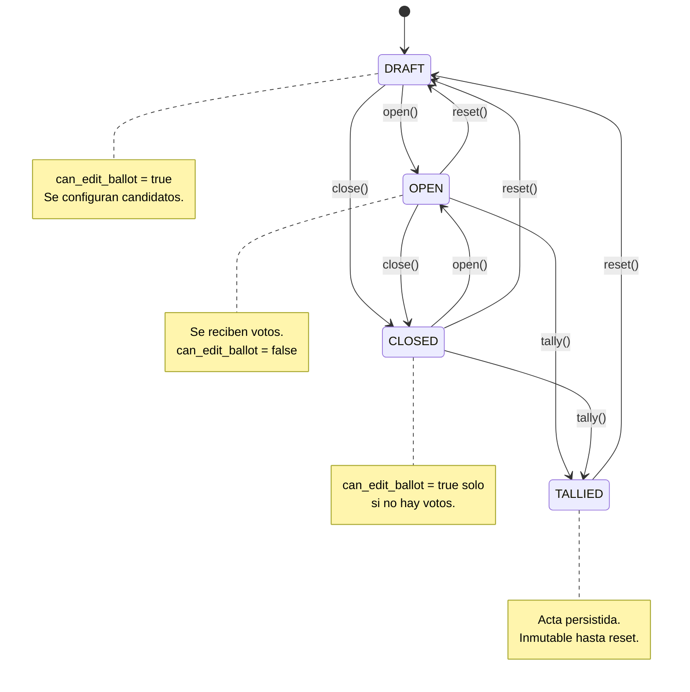
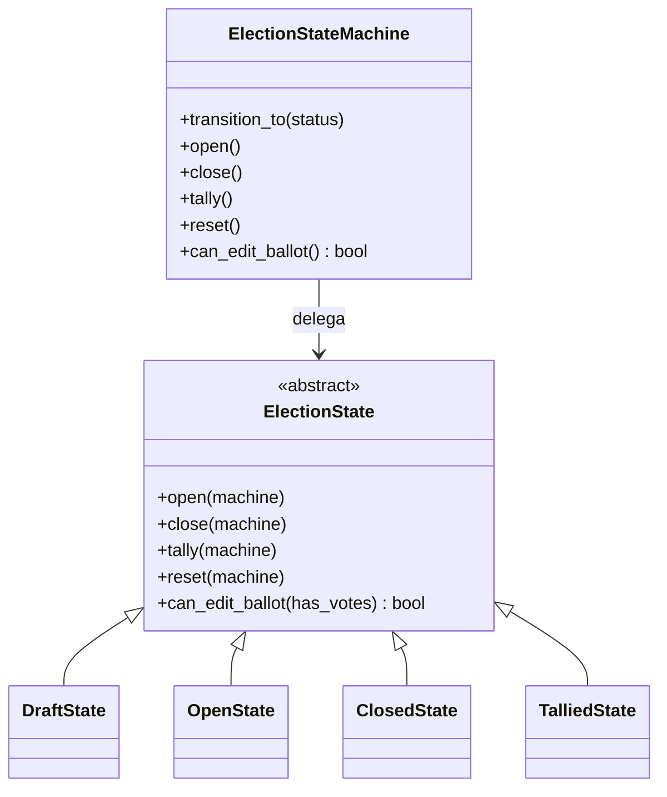
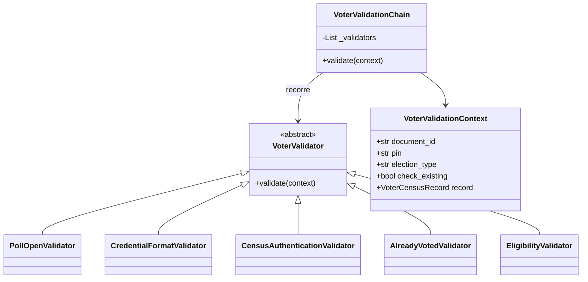
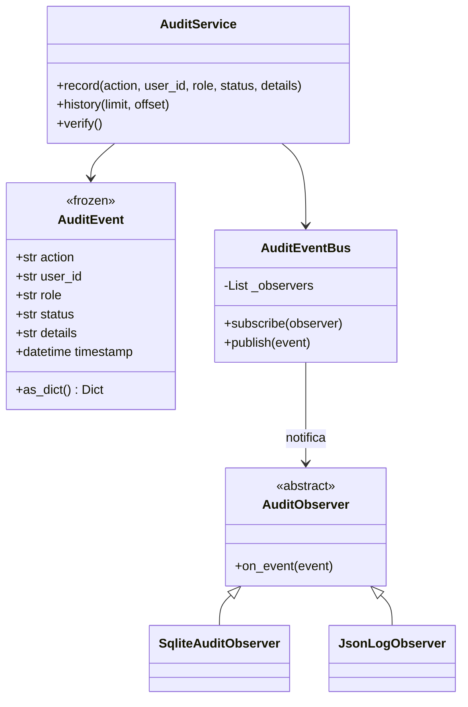

# Patrones de comportamiento

> Documento técnico de la categoría **comportamiento** del catálogo GoF.
> Cubre los once patrones: State, Chain of Responsibility, Observer, Strategy,
> Command, Iterator, Mediator, Memento, Template Method, Visitor e Interpreter.
> La aplicación implementa tres; los otros ocho se evaluaron y no se adoptaron.
> Cada sección conserva el formato de identificación, problema, estructura,
> implementación, análisis, pruebas y límites.

## Ficha de la categoría

| Aspecto | Descripción |
|---|---|
| Categoría | Comportamiento |
| Pregunta que responde | ¿Cómo se comunican los objetos y cómo se asignan responsabilidades sin acoplarlos? |
| Patrones implementados | State, Chain of Responsibility, Observer |
| Patrones evaluados y no adoptados | Strategy, Command, Iterator, Mediator, Memento, Template Method, Visitor, Interpreter |
| Archivos principales | `src/modules/election/state.py`, `src/modules/voting/voter_validation.py`, `src/modules/audit/` |
| Evidencia | `tests/unit/test_state_machine.py`, `tests/integration/test_voting_flow.py`, `tests/integration/test_admin_flow.py`, `tests/integration/test_candidates_and_tally.py` |

## Contenido

1. [State](#1-state)
2. [Chain of Responsibility](#2-chain-of-responsibility)
3. [Observer](#3-observer)
4. [Evaluados y no adoptados](#4-evaluados-y-no-adoptados)
5. [Conclusión de la categoría](#5-conclusión-de-la-categoría)

## Matriz de decisión

| Patrón | ¿Se usa? | Dónde | Decisión |
|---|---|---|---|
| **State** | Sí | `src/modules/election/state.py` | Mantener: ciclo de vida persistente. |
| **Chain of Responsibility** | Sí | `src/modules/voting/voter_validation.py` | Mantener: cinco validaciones ordenadas. |
| **Observer** | Sí | `src/modules/audit/service.py` | Mantener: auditoría y sumideros. |
| **Strategy** | Latente | `src/modules/election/election_factory.py` | No duplicar: `TallyRule` ya es una familia de algoritmos. |
| **Command** | No | — | No ahora: el Proxy ya autoriza y audita; `undo` de votos es inadmisible. |
| **Iterator** | No | — | No: Python ya itera; no hay colección compleja. |
| **Mediator** | No | — | No: no hay red de componentes que se comuniquen. |
| **Memento** | No | — | No: una foto del estado de votos puede romper el secreto. |
| **Template Method** | No | — | No: el Builder ya fija el orden del acta. |
| **Visitor** | No | — | Diferir: útil si se agregara exportación múltiple del acta. |
| **Interpreter** | No | — | No: no hay lenguaje de reglas configurable. |

## Criterio de selección

El análisis de diseño advierte dos riesgos: **Chain** hace menos evidente el
flujo que un `if` lineal, y **Command** puede ser sobreingeniería cuando la
operación es simple. Por eso no se implementaron los once patrones.

Se adoptaron tres porque resolvían problemas verificables:

1. La jornada tenía estado dividido entre memoria y SQLite.
2. La validación del elector acumulaba cinco comprobaciones en un método.
3. La auditoría era una lista en memoria que se perdía al reiniciar.

Los demás se evaluaron contra el dominio y se documentan con su motivo de
descarte y su condición de retorno.

---

# 1. State

## 1.1 Identificación

| Campo | Valor |
|---|---|
| Patrón | State |
| Categoría | Comportamiento |
| Elementos | `ElectionState`, `DraftState`, `OpenState`, `ClosedState`, `TalliedState`, `ElectionStateMachine` |
| Archivo | [`src/modules/election/state.py`](../../src/modules/election/state.py) |
| Intención GoF | Permitir que un objeto altere su comportamiento cuando cambia su estado interno. |
| Referencia | Gamma et al. (1994), p. 305. |

## 1.2 Problema y fuerzas del dominio

Antes de State, la jornada tenía dos banderas en lugares distintos:

- `is_open` vivía en el Singleton, en memoria.
- `is_tallied` vivía en SQLite.

Las reglas estaban repartidas en condicionales:

- no abrir si ya fue escrutada,
- no votar si está cerrada,
- no escrutar dos veces,
- reiniciar borra votos y reabre.

Ese diseño permitía estados incoherentes. Por ejemplo, el Proxy podía registrar
una apertura “autorizada” y la fachada rechazarla después por estar escrutada.

## 1.3 Modelo estructural





**Participantes.**

| Rol | Elemento | Responsabilidad |
|---|---|---|
| Contexto | `ElectionStateMachine` | Carga el estado persistido y delega. |
| Estado abstracto | `ElectionState` | Declara transiciones y edición de papeleta. |
| Estados concretos | `DraftState`, `OpenState`, `ClosedState`, `TalliedState` | Deciden qué transición es válida. |
| Persistencia | `election_state.status` | Fuente de verdad del estado. |

## 1.4 Implementación

```python
class ElectionStatus(str, Enum):
    DRAFT = "DRAFT"
    OPEN = "OPEN"
    CLOSED = "CLOSED"
    TALLIED = "TALLIED"

class OpenState(ElectionState):
    status = ElectionStatus.OPEN

    def close(self, machine):
        machine.transition_to(ElectionStatus.CLOSED)

    def tally(self, machine):
        machine.transition_to(ElectionStatus.TALLIED)

    def can_edit_ballot(self, has_votes: bool) -> bool:
        return False

class ElectionStateMachine:
    def __init__(self, election_type: str) -> None:
        init_db()
        self.election_type = election_type.upper().strip()
        self._state = self._build_state(get_election_status(self.election_type))

    def transition_to(self, status: ElectionStatus) -> None:
        set_election_status(self.election_type, status.value)
        self._state = self._build_state(status.value)
```

`TalliedState.open()` lanza `InvalidStateTransition`; `reset()` vuelve a `DRAFT`
después de borrar los votos. `can_edit_ballot()` es verdadero en `DRAFT` o en
`CLOSED` sin votos.

## 1.5 Análisis de ingeniería

**Fuente única de verdad.** `status` reemplaza la combinación de `is_open` en
memoria e `is_tallied` en SQLite.

**Transiciones explícitas.** Abrir una jornada escrutada falla con un error de
dominio, no con un `if` olvidado.

**Persistencia.** El estado sobrevive al reinicio. El reinicio de jornada deja
`DRAFT`; no reabre automáticamente.

**Límite de concurrencia.** Es un estado persistente, pero no un sistema
distribuido. Dos procesos podrían competir por la misma transición; en local hay
un solo proceso.

## 1.6 Pruebas y límites

- `tests/unit/test_state_machine.py::test_election_state_machine_transitions`
  cubre todas las transiciones y el rechazo de apertura tras el acta.
- `tests/integration/test_admin_flow.py::test_tally_builder_and_proxy_audit`
  verifica que no se reabra ni se escrute dos veces.
- `tests/integration/test_census_and_dashboard.py::test_reset_election_keeps_census`
  verifica que el reset deje `DRAFT` y conserve el censo.

**Límite.** No hay bloqueo optimista ni transacciones de estado entre
procesos. Para producción habría que agregar control de concurrencia.

# 2. Chain of Responsibility

## 2.1 Identificación

| Campo | Valor |
|---|---|
| Patrón | Chain of Responsibility |
| Categoría | Comportamiento |
| Elementos | `VoterValidator`, `PollOpenValidator`, `CredentialFormatValidator`, `CensusAuthenticationValidator`, `AlreadyVotedValidator`, `EligibilityValidator`, `VoterValidationChain` |
| Archivo | [`src/modules/voting/voter_validation.py`](../../src/modules/voting/voter_validation.py) |
| Intención GoF | Evitar acoplar el emisor de una solicitud a su receptor, dando a varios objetos la oportunidad de manejarla. |
| Referencia | Gamma et al. (1994), p. 223. |

## 2.2 Problema y fuerzas del dominio

`verify_voter` tenía cinco comprobaciones en un solo método:

1. urna abierta,
2. formato de credencial,
3. documento + PIN contra el censo,
4. voto previo,
5. habilitación.

Funcionaba, pero mezclaba responsabilidades y devolvía un `dict` con motivos
distintos. Probar una regla aislada obligaba a construir todo el contexto.

## 2.3 Modelo estructural



**Orden real de la cadena.**

```text
PollOpen → CredentialFormat → CensusAuthentication → AlreadyVoted → Eligibility
```

**Participantes.**

| Rol | Elemento | Responsabilidad |
|---|---|---|
| Handler | `VoterValidator` | Contrato de validación. |
| Handlers concretos | PollOpen, Format, Census, AlreadyVoted, Eligibility | Una regla cada uno. |
| Cadena | `VoterValidationChain` | Recorre en orden y detiene al fallar. |
| Contexto | `VoterValidationContext` | Documento, PIN, modalidad y registro parcial. |
| Cliente | `VoteService` | Ejecuta la cadena y traduce el error. |

## 2.4 Implementación

```python
@dataclass
class VoterValidationContext:
    document_id: str
    pin: str
    election_type: str
    check_existing: bool = True
    record: Optional[VoterCensusRecord] = None

class PollOpenValidator(VoterValidator):
    def __init__(self, state_machine: ElectionStateMachine) -> None:
        self._state_machine = state_machine

    def validate(self, context: VoterValidationContext) -> None:
        if not self._state_machine.is_open:
            raise VoterValidationError("La jornada de votación no está abierta.")

class VoterValidationChain:
    def __init__(self, validators: List[VoterValidator]) -> None:
        self._validators = list(validators)

    def validate(self, context: VoterValidationContext) -> None:
        for validator in self._validators:
            validator.validate(context)
```

`AlreadyVotedValidator` solo actúa si `check_existing=True`. La emisión real usa
`check_existing=False` porque la restricción única de `voter_participation` es la
garantía atómica contra el doble voto.

## 2.5 Análisis de ingeniería

**SRP.** Cada validador tiene una regla y un mensaje. Es fácil probar o reordenar.

**OCP.** Agregar una validación es agregar un eslabón, no modificar la fachada.

**Acoplamiento.** La cadena usa un contexto común; los validadores no se conocen
entre sí.

**Costo.** Hay más clases y el flujo no es lineal a simple vista. Se justifica
porque hay cinco validaciones reales; con una o dos, un `if` sería más claro.

## 2.6 Pruebas y límites

- `tests/integration/test_voting_flow.py::test_voter_authentication_with_pin`
  cubre PIN incorrecto y elector inhabilitado.
- `tests/integration/test_voting_flow.py::test_validation_chain_rejects_closed_poll`
  verifica el motivo cuando la urna está cerrada.
- `tests/integration/test_voting_flow.py::test_secure_vote_and_duplicate` cubre
  el doble voto en la emisión.

**Límite.** La cadena no reemplaza la transacción ni la restricción
única. La comprobación previa ayuda a dar un mensaje claro; la base es la
garantía final.

# 3. Observer

## 3.1 Identificación

| Campo | Valor |
|---|---|
| Patrón | Observer |
| Categoría | Comportamiento |
| Elementos | `AuditEvent`, `AuditObserver`, `AuditEventBus`, `SqliteAuditObserver`, `JsonLogObserver`, `AuditService` |
| Archivos | [`src/modules/audit/service.py`](../../src/modules/audit/service.py), [`src/core/database.py`](../../src/core/database.py) |
| Intención GoF | Definir una dependencia uno-a-muchos para notificar cambios a todos los interesados. |
| Referencia | Gamma et al. (1994), p. 293. |

## 3.2 Problema y fuerzas del dominio

La bitácora del Proxy era una lista en memoria. Al reiniciar se perdía, y no había
forma de enviar el mismo evento a un log técnico sin acoplar el Proxy a cada
destino.

La auditoría necesita:

- persistencia,
- verificación de integridad,
- log técnico,
- posibilidad de agregar un sumidero sin tocar el Proxy.

## 3.3 Modelo estructural



**Participantes.**

| Rol | Elemento | Responsabilidad |
|---|---|---|
| Sujeto | `AuditService` / `AuditEventBus` | Publica eventos y notifica. |
| Observador abstracto | `AuditObserver` | Contrato `on_event`. |
| Observador primario | `SqliteAuditObserver` | Persiste con hash chain. |
| Observador secundario | `JsonLogObserver` | Deja una línea JSON en el log. |
| Cliente | `ElectoralAccessProxy` | Publica eventos de acceso y operaciones. |

## 3.4 Implementación

```python
@dataclass(frozen=True)
class AuditEvent:
    action: str
    user_id: str
    role: str
    status: str
    details: str = ""
    timestamp: datetime = field(default_factory=lambda: datetime.now(timezone.utc))

class AuditEventBus:
    def __init__(self) -> None:
        self._observers: List[AuditObserver] = []

    def subscribe(self, observer: AuditObserver) -> None:
        self._observers.append(observer)

    def publish(self, event: AuditEvent) -> None:
        for observer in self._observers:
            observer.on_event(event)

class AuditService:
    def record(self, action, user_id, role, status, details=""):
        self._bus.publish(AuditEvent(action, user_id, role, status, details))
```

Cada evento persistido guarda `prev_hash` y `event_hash`:

```text
H1 = SHA256("GENESIS" + evento1)
H2 = SHA256(H1 + evento2)
H3 = SHA256(H2 + evento3)
```

Si se altera un evento del medio, la verificación falla y reporta la fila rota.
Detecta manipulación, no la impide.

## 3.5 Análisis de ingeniería

**OCP.** Agregar un sumidero (por ejemplo, métricas) es suscribir un observador,
no modificar el Proxy.

**SRP.** El Proxy decide **qué** auditar; los observadores deciden **dónde**
guardarlo.

**Persistencia.** `audit_events` sobrevive al reinicio. `history()` lee de SQLite,
no de memoria.

**Límite.** La auditoría es tamper-evident, no tamper-proof. Un administrador con
acceso a la base podría reescribir la cadena completa. Para producción faltan
firmas asimétricas, WORM y anclaje externo.

## 3.6 Pruebas y límites

- `tests/integration/test_admin_flow.py::test_audit_log_is_persistent_and_verifiable`
  verifica persistencia y cadena válida.
- `tests/integration/test_admin_flow.py::test_audit_chain_detects_tampering`
  altera un evento, detecta la ruptura y lo restaura.
- `tests/integration/test_admin_flow.py::test_audit_log_can_be_exported`
  verifica descarga JSON/CSV.

**Límite.** El observador SQLite es la fuente de verdad; el log JSON es
secundario. Si la escritura de auditoría falla, el Proxy registra el fallo en el
log técnico, pero no revierte una operación ya confirmada. En producción se
usaría una outbox transaccional.

# 4. Evaluados y no adoptados

## 4.1 Strategy (latente)

**Intención.** Definir una familia de algoritmos intercambiables.

**Estado en el proyecto.** `TallyRule` con `AbsoluteMajorityTallyRule` y
`SimplePluralityTallyRule` ya es una familia de algoritmos intercambiables. La
fábrica electoral decide cuál usar.

**Por qué no se agrega otra clase.** Crear un `Strategy` adicional sería duplicar
el mismo rol. Se documenta el patrón latente para no inflar el conteo.

**Condición de retorno.** Si la regla de escrutinio se configurara por elección
desde la base, se extraería una interfaz `TallyStrategy` explícita.

## 4.2 Command

**Intención.** Encapsular una solicitud como objeto, permitiendo encolar, registrar
o deshacer.

**Por qué no se usa.** El Proxy ya autoriza, audita y delega las operaciones
administrativas. `undo` de un voto es inadmisible: implicaría identificar qué
voto revertir y romper el secreto. `undo` de configuración no está en los
objetivos.

**Condición de retorno.** Una cola de tareas, aprobación masiva o ejecución
diferida de operaciones administrativas.

## 4.3 Iterator

**Intención.** Recorrer una colección sin exponer su representación interna.

**Por qué no se usa.** El censo se lista completo; Python ya ofrece iteración
sobre listas y consultas. Con 82 electores no hay un problema de recorrido que
justifique una jerarquía.

**Condición de retorno.** Paginación real, recorrido de un árbol territorial o
una fuente externa con cursor.

## 4.4 Mediator

**Intención.** Centralizar la comunicación entre un conjunto de objetos.

**Por qué no se usa.** No hay una red de componentes de UI que se hablen entre sí.
La API y la fachada ya coordinan el caso de uso. Sería un intermediario sin
colegas.

**Condición de retorno.** Un formulario complejo con múltiples componentes que
reaccionan entre sí.

## 4.5 Memento

**Intención.** Capturar y restaurar el estado interno sin violar encapsulamiento.

**Por qué no se usa.** Guardar una “foto” del estado de la votación para deshacer
es peligroso para el secreto y la integridad. Un memento de papeletas podría
reconstruir la relación identidad-voto.

**Condición de retorno.** Deshacer de borradores de configuración, nunca de votos
emitidos.

## 4.6 Template Method

**Intención.** Definir el esqueleto de un algoritmo y delegar pasos a subclases.

**Por qué no se usa.** El Builder ya fija el orden del acta y el servicio de
escrutinio coordina los pasos. Un Template Method para el mismo flujo sería dos
patrones resolviendo el mismo problema.

**Condición de retorno.** Varias modalidades de acta con pasos fijos y detalles
distintos.

## 4.7 Visitor

**Intención.** Agregar operaciones a una estructura sin modificar sus clases.

**Por qué no se usa.** No hay una jerarquía de elementos que recorra múltiples
operaciones. El acta es un producto plano y se exporta JSON/CSV con funciones
simples.

**Condición de retorno.** Exportación múltiple (PDF, CSV, JSON) sobre una
estructura de secciones del acta.

## 4.8 Interpreter

**Intención.** Definir una gramática y un intérprete para evaluar expresiones.

**Por qué no se usa.** No hay reglas configurables en texto ni un lenguaje de
consulta. Sería complejidad sin caso de uso.

**Condición de retorno.** Un motor de reglas electorales configurable por el
usuario.

---

# 5. Conclusión de la categoría

Se implementaron tres patrones de comportamiento:

- **State** resolvió el estado dividido y las transiciones inválidas.
- **Chain** separó las cinco validaciones del elector.
- **Observer** convirtió la auditoría en un registro persistente y extensible.

Los otros ocho se evaluaron con el mismo criterio: ¿resuelven un problema actual
del dominio? Si la respuesta era “todavía no”, se documentó la condición que los
haría volver. Esa es la diferencia entre un catálogo de patrones y una lista de
nombres.
