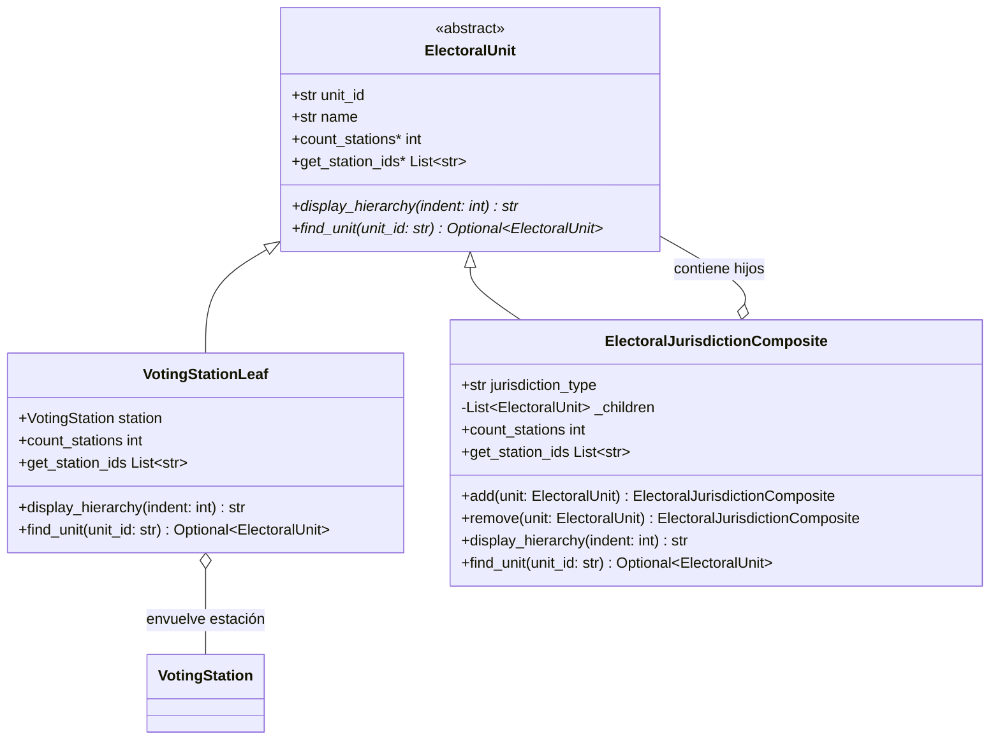
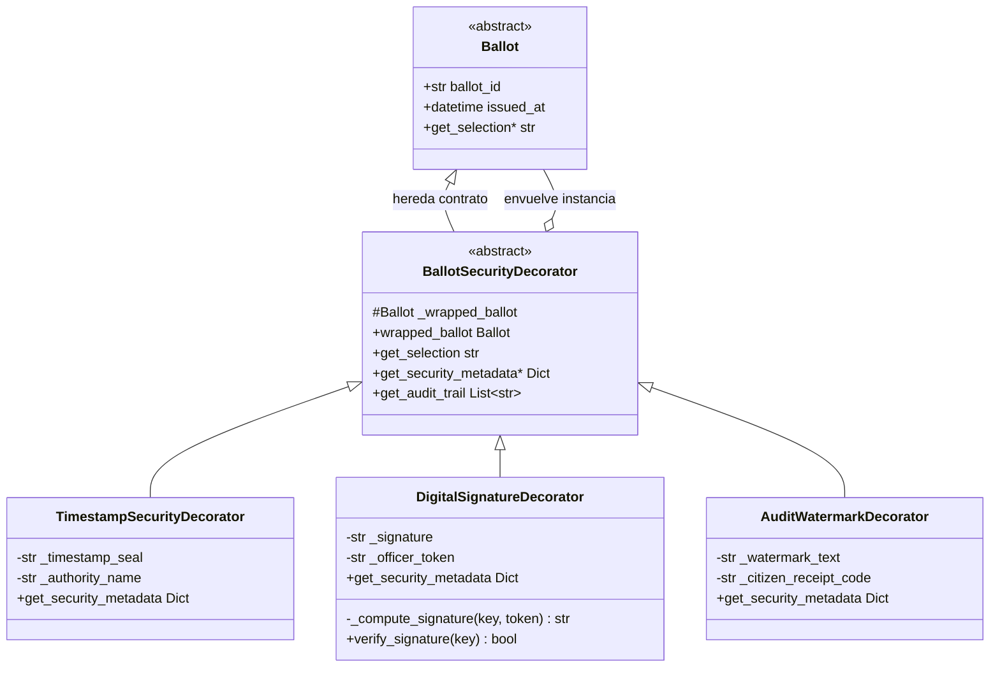
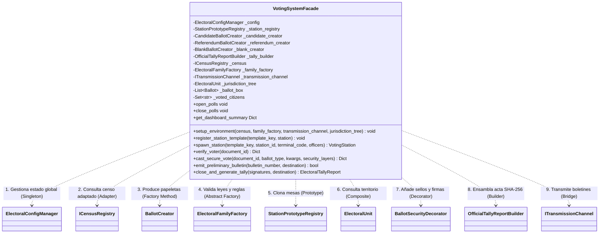

# Patrones de Diseño Composite, Decorator (Profundización) y Facade

## 1. Identificación del patrón
* **Patrones de Diseño:** Composite, Decorator (Profundización) y Facade (Patrones Estructurales).
* **Elementos del Sistema:**
  * **Estructura Territorial y Mesas (Composite):** Componente abstracto `ElectoralUnit`, hoja terminal `VotingStationLeaf` y contenedor jerárquico `ElectoralJurisdictionComposite`.
  * **Seguridad y Trazabilidad del Voto (Decorator):** Decorador base `BallotSecurityDecorator`, y decoradores concretos `TimestampSecurityDecorator`, `DigitalSignatureDecorator` y `AuditWatermarkDecorator`.
  * **Orquestador Unificado del Sistema (Facade):** Fachada central `VotingSystemFacade` que coordina los subsistemas creacionales y estructurales en una interfaz de alto nivel.
* **Ubicación del Código:**
  * `src/modules/election/jurisdiction_composite.py`
  * `src/modules/voting/ballot_decorator.py`
  * `src/modules/facade/voting_facade.py`

---

## 2. Justificación y Problema que Resuelven en el Dominio

El sistema integra tres patrones estructurales para resolver necesidades críticas del proceso electoral:

### 2.1 Justificación de COMPOSITE: Organización Territorial y de Recintos
Un proceso electoral se organiza de forma natural como un árbol jerárquico parte-todo:
- Una **Circunscripción o Institución** se divide en **Zonas o Facultades**.
- Cada Zona agrupa múltiples **Puestos de Votación** (colegios o campus).
- Cada Puesto contiene un número variable de **Mesas de Votación individuales** (`VotingStation`).

**Problema que evita:** Sin Composite, el cliente tendría que escribir algoritmos diferentes y condicionales `if/else` para consultar cuántas mesas tiene un puesto, cuántas tiene una comuna y cuántas tiene todo el país.
**Solución Composite:** Define la interfaz común `ElectoralUnit`. El cliente trata con idéntica uniformidad a una mesa individual (hoja) que a una circunscripción nacional entera (compuesto), propagando operaciones recursivas (`count_stations`, `get_station_ids`, `display_hierarchy`).

### 2.2 Justificación de DECORATOR (Profundización): Seguridad Dinámica del Voto
Una papeleta emitida (`Ballot`) almacena la opción elegida por el votante. No obstante, según la legislación de la jornada y los requerimientos de auditoría, el sufragio requiere capas de seguridad añadidas:
1. Sello de tiempo UTC certificado con reloj atómico oficial.
2. Sello de integridad HMAC-SHA256 con clave del servicio y terminal de emisión.
3. Código de recibo y marca de agua forense para verificación del ciudadano.

**El Antipatrón Evitado (Explosión de Subclases):**
Si intentáramos modelar estas combinaciones mediante herencia de clases, tendríamos una explosión de $2^n$ clases (`BallotConTimestamp`, `BallotConTimestampYFirma`, `BallotConTimestampFirmaYMarca`, etc.).
**Solución Decorator:** Envuelve dinámicamente el voto en memoria en tiempo de ejecución. Permite anidar tantas capas de seguridad como la elección demande (`DigitalSignatureDecorator(TimestampSecurityDecorator(ballot))`) sin alterar la entidad base `Ballot` y garantizando que el objeto siga cumpliendo la interfaz de sufragio.

### 2.3 Justificación de FACADE: La Puerta de Entrada hacia la Interfaz Gráfica
Hasta este punto, el sistema cuenta con **9 patrones GoF implementados y coordinados**. Si la futura capa web (FastAPI, Swagger UI o plantillas HTML) tuviera que interactuar directamente con cada módulo:
- Cada endpoint requeriría decenas de líneas de código instanciando fábricas, adaptadores de censo, constructores de actas y validadores.
- La capa de presentación quedaría fuertemente acoplada a las clases internas del dominio.

**Solución Facade:** `VotingSystemFacade` expone operaciones de alto nivel (`open_polls`, `verify_voter`, `cast_secure_vote`, `close_and_generate_tally`), encapsulando la complejidad y dejando el sistema listo para conectarse a cualquier interfaz de usuario sin escribir código espagueti.

---

## 3. Parte A: Patrón de Diseño COMPOSITE

### 3.1 Modelo Estructural y Diagrama de Clases (UML)



### 3.2 Implementación Técnica en Código (`src/modules/election/jurisdiction_composite.py`)

```python
class ElectoralUnit(ABC):
    """Componente abstracto base para elementos de la jerarquía territorial electoral."""

    def __init__(self, unit_id: str, name: str) -> None:
        self.unit_id = unit_id
        self.name = name

    @abstractmethod
    def count_stations(self) -> int:
        pass

    @abstractmethod
    def get_station_ids(self) -> List[str]:
        pass

class VotingStationLeaf(ElectoralUnit):
    """Hoja (Leaf) que representa una mesa de votación individual terminal."""

    def __init__(self, station: VotingStation) -> None:
        super.__init__(unit_id=station.station_id, name=f"Mesa {station.station_id}")
        self.station = station

    def count_stations(self) -> int:
        return 1

    def get_station_ids(self) -> List[str]:
        return [self.station.station_id]

class ElectoralJurisdictionComposite(ElectoralUnit):
    """Compuesto (Composite) que agrupa unidades electorales recursivamente."""

    def __init__(self, unit_id: str, name: str, jurisdiction_type: str = "ZONA") -> None:
        super.__init__(unit_id, name)
        self.jurisdiction_type = jurisdiction_type.upper
        self._children: List[ElectoralUnit] = []

    def add(self, unit: ElectoralUnit) -> ElectoralJurisdictionComposite:
        if unit not in self._children:
            self._children.append(unit)
        return self

    def count_stations(self) -> int:
        return sum(child.count_stations for child in self._children)

    def get_station_ids(self) -> List[str]:
        station_ids: List[str] = []
        for child in self._children:
            station_ids.extend(child.get_station_ids)
        return station_ids
```

---

## 4. Parte B: Patrón de Diseño DECORATOR (Profundización)

### 4.1 Modelo Estructural y Diagrama de Clases (UML)



### 4.2 Implementación Técnica en Código (`src/modules/voting/ballot_decorator.py`)

```python
class BallotSecurityDecorator(Ballot, ABC):
    """Decorador abstracto base que envuelve una papeleta conservando su contrato."""

    def __init__(self, wrapped_ballot: Ballot) -> None:
        super.__init__(ballot_id=wrapped_ballot.ballot_id, issued_at=wrapped_ballot.issued_at)
        object.__setattr__(self, "_wrapped_ballot", wrapped_ballot)

    def get_selection(self) -> str:
        return self.wrapped_ballot.get_selection

    @abstractmethod
    def get_security_metadata(self) -> Dict[str, Any]:
        pass

class DigitalSignatureDecorator(BallotSecurityDecorator):
    """Decorador concreto que sella criptográficamente la papeleta mediante HMAC-SHA256."""

    def __init__(self, wrapped_ballot: Ballot, signing_key: str, officer_token: str) -> None:
        super.__init__(wrapped_ballot)
        signature = self._compute_signature(signing_key, officer_token)
        object.__setattr__(self, "_signature", signature)
        object.__setattr__(self, "_officer_token", officer_token)

    def _compute_signature(self, signing_key: str, officer_token: str) -> str:
        canonical_content = f"{self.ballot_id}:{self.get_selection}:{self.issued_at.isoformat}:{officer_token}"
        return hmac.new(
            key=signing_key.encode("utf-8"),
            msg=canonical_content.encode("utf-8"),
            digestmod=hashlib.sha256,
        ).hexdigest

    def verify_signature(self, signing_key: str) -> bool:
        expected = self._compute_signature(signing_key, getattr(self, "_officer_token"))
        return hmac.compare_digest(getattr(self, "_signature"), expected)
```

---

## 5. Parte C: Patrón de Diseño FACADE

### 5.1 Modelo Estructural y Diagrama de Clases (UML)



### 5.2 Implementación Técnica en Código (`src/modules/facade/voting_facade.py`)

La clase `VotingSystemFacade` concentra y coordina todos los subsistemas en métodos de alto nivel:

```python
class VotingSystemFacade:
    """Fachada unificada de alto nivel para el sistema electoral."""

    def __init__(self, institution_name: str, election_title: str) -> None:
        self._config = ElectoralConfigManager(institution_name, election_title)
        self._station_registry = StationPrototypeRegistry
        self._candidate_creator = CandidateBallotCreator
        self._referendum_creator = ReferendumBallotCreator
        self._blank_creator = BlankBallotCreator
        self._tally_builder = OfficialTallyReportBuilder
        self._ballot_box: List[Ballot] = []
        self._voted_citizens: Set[str] = set

    def verify_voter(self, document_id: str) -> Dict[str, Any]:
        # Valida que la urna esté abierta, formato del documento, no duplicidad y censo
        ...

    def cast_secure_vote(self, document_id: str, ballot_type: str, selection_kwargs: Dict[str, Any],
                         security_layers: List[str] = ("timestamp", "signature", "watermark")) -> Dict[str, Any]:
        # Valida elegibilidad, fabrica papeleta, aplica decoradores y custodia en urna anónima
        ...

    def close_and_generate_tally(self, officer_signatures: List[str],
                                 dispatch_destination: Optional[str] = None) -> ElectoralTallyReport:
        # Cierra urnas, totaliza votos, construye acta consolidada con Builder y transmite por Bridge
        ...
```

---

## 6. Análisis de Ingeniería de Software

### 6.1 Relación entre los patrones
El sistema articula los patrones estructurales para resolver los problemas de integración y coordinación:
1. **Adapter:** Resolvió la incompatibilidad del censo de electores (JSON vs CSV).
2. **Bridge:** Desacopló los boletines oficiales de los canales físicos de transporte (Consola, Archivo, Sink).
3. **Composite:** Jerarquizó el mapa electoral unificando el tratamiento de mesas individuales y recintos completos.
4. **Decorator:** Dotó a las papeletas de capas dinámicas de seguridad acumulativas (HMAC, marcas y tiempo).
5. **Facade:** Creó una interfaz unificada y limpia que encapsula toda la arquitectura.

### 6.2 Cumplimiento de Principios SOLID
* **Single Responsibility Principle (SRP):** El cliente web o API solo invoca a `VotingSystemFacade` para orquestar la jornada; la fachada delega cada subtarea a su respectivo módulo especializado.
* **Open/Closed Principle (OCP):** Nuevos decoradores de seguridad (ej. firma asimétrica Ed25519) pueden envolver a las papeletas sin modificar el código de la clase base `Ballot` ni de las fábricas.
* **Liskov Substitution Principle (LSP):** Cualquier `ElectoralUnit` (sea `VotingStationLeaf` o `ElectoralJurisdictionComposite`) puede ser consultada indistintamente para contabilizar mesas o recopilar identificadores.
* **Dependency Inversion Principle (DIP):** La fachada depende exclusivamente de abstracciones e interfaces (`ICensusRegistry`, `ITransmissionChannel`, `ElectoralFamilyFactory`, `ElectoralUnit`), inyectadas limpiamente mediante `setup_environment`.

---

## 7. Conclusión: Integración con la capa visual

Con la implementación de `VotingSystemFacade`, **la arquitectura queda 100% lista para construir la interfaz gráfica y los endpoints de FastAPI**.

A partir de este punto, la capa web no requiere interactuar con fábricas ni constructores internos; cada controlador REST o formulario HTML interactúa directamente con los métodos limpios del Facade:
* `facade.verify_voter(cedula)`
* `facade.cast_secure_vote(cedula, tipo, seleccion)`
* `facade.get_dashboard_summary`
* `facade.close_and_generate_tally(firmas)`