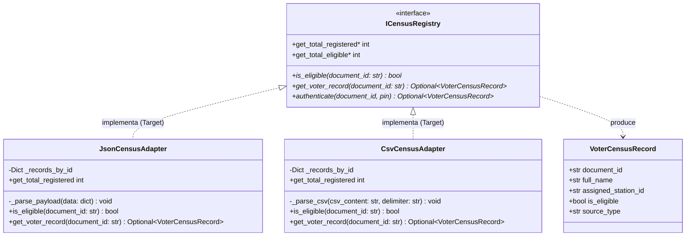
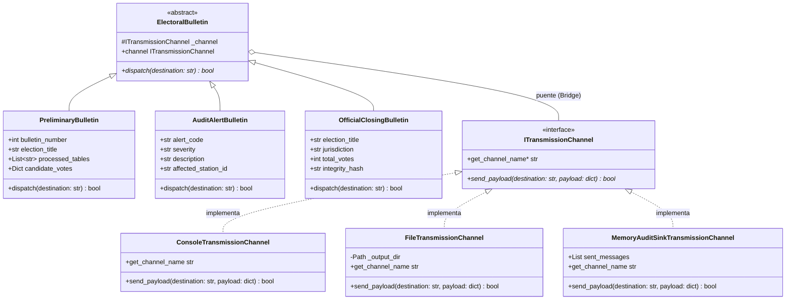

# Patrones de Diseño Adapter y Bridge

## 1. Identificación del patrón
* **Patrones de Diseño:** Adapter y Bridge (Patrones Estructurales).
* **Elementos del Sistema:**
  * **Módulo de Censo Electoral (Adapter):** Interfaz canónica `ICensusRegistry`, entidad inmutable `VoterCensusRecord`, y adaptadores concretos `JsonCensusAdapter`, `CsvCensusAdapter` y `SqliteCensusAdapter` (fuente activa en la demo).
  * **Módulo de Transmisión Multicanal (Bridge):** Abstracción base `ElectoralBulletin` con sus refinamientos (`PreliminaryBulletin`, `AuditAlertBulletin`, `OfficialClosingBulletin`), conectada mediante puente a la interfaz implementadora `ITransmissionChannel` (`ConsoleTransmissionChannel`, `FileTransmissionChannel`, `MemoryAuditSinkTransmissionChannel`).
* **Ubicación del Código:**
  * `src/modules/census/census_adapter.py`
  * `src/modules/transmission/bulletin_bridge.py`

---

## 2. Justificación y Problema que Resuelven en el Dominio

En esta etapa del sistema electoral, el reto principal consiste en **conectar y comunicar componentes heterogéneos sin acoplar la arquitectura**:

### 2.1 Problemática de Incompatibilidad de Fuentes: Justificación de ADAPTER
Para ejercer el voto, el sistema debe consultar un padrón electoral oficial. Sin embargo, en la práctica gubernamental e institucional, los censos provienen de orígenes completamente dispares:
1. **Elecciones Nacionales:** La Registraduría Nacional expide volcados masivos en formato de texto plano CSV con encabezados legados (`cedula,nombre_apellidos,mesa_num,habilitado_sufragio`).
2. **Elecciones Institucionales o Universitarias:** Las oficinas de registro y control proveen APIs REST o exportaciones JSON estructuradas con llaves diferentes (`codigo,nombres,mesa,activo`).

Si el motor de votación se programara para leer directamente las llaves de un JSON o las columnas de un CSV, se violaría gravemente el principio de inversión de dependencias (DIP) y el principio de responsabilidad única (SRP). Cualquier cambio en la estructura del archivo externo rompería la lógica electoral.

El patrón **Adapter** resuelve esta incompatibilidad actuando como un traductor intermedio: envuelve la estructura externa no estándar (*Adaptee*) y expone la interfaz unificada que el sistema electoral espera (*Target*: `ICensusRegistry`).

### 2.2 Problemática de Explosión Combinatoria en la Transmisión: Justificación de BRIDGE
Durante el transcurso de las elecciones y al cierre de urnas, se requiere difundir información oficial hacia el exterior. Este flujo varía de manera independiente en **dos dimensiones ortogonales**:
* **Dimensión 1 (El "Qué" se transmite - Abstracción):** Distintos tipos de boletines con información y propósitos disímiles:
  - *Boletín Preliminar:* Avance parcial del conteo de votos en vivo con porcentaje de mesas informadas.
  - *Alerta de Seguridad/Auditoría:* Notificación urgente por incidencias críticas (ej. intento de doble sufragio, alteración de precinto).
  - *Boletín de Cierre Oficial:* Acta definitiva de escrutinio con sello de integridad SHA-256.
* **Dimensión 2 (El "Cómo / Dónde" se despacha - Implementador):** Múltiples medios técnicos o canales de salida:
  - *Consola / Log de Operaciones del Sistema.*
  - *Almacenamiento Local Sellado en Archivo de Disco.*
  - *Receptor de Memoria (Sink) para Auditoría y Testing Automatizado.*

#### El Antipatrón de Herencia Evitado (Explosión Combinatoria):
Si resolviéramos esta necesidad mediante herencia tradicional, tendríamos que crear clases para cada combinación posible:
`PreliminaryBulletinConsole`, `PreliminaryBulletinFile`, `AuditAlertConsole`, `AuditAlertFile`, `ClosingBulletinConsole`, etc.
Con 3 tipos de boletines y 3 canales de salida, se requerirían **$3 \times 3 = 9$ clases**. Si el día de mañana se agrega un nuevo canal (ej. Webhook REST o Transmisión Satelital), se sumarían 3 clases más por cada nuevo medio.

El patrón **Bridge** resuelve este dilema desacoplando la jerarquía de abstracción (los boletines) de la jerarquía de implementación (los canales de transporte), combinándolos por **composición**. Esto reduce el número total de clases a **$3 + 3 = 6$**, permitiendo que cualquiera de las dos jerarquías crezca de forma autónoma sin impactar a la otra.

---

## 3. Parte A: Patrón de Diseño ADAPTER

### 3.1 Modelo Estructural y Diagrama de Clases (UML)

El siguiente diagrama modela la interfaz objetivo `ICensusRegistry` (Target), el registro canónico de elector `VoterCensusRecord`, y los dos adaptadores de objeto concretos (`JsonCensusAdapter` y `CsvCensusAdapter`):



### 3.2 Implementación Técnica en el Código (`src/modules/census/census_adapter.py`)

#### Interfaz Objetivo (Target) y Entidad Canónica:
```python
@dataclass(frozen=True)
class VoterCensusRecord:
    """Representación canónica e inmutable de un registro de censo en el dominio."""
    document_id: str
    full_name: str
    assigned_station_id: str
    is_eligible: bool
    source_type: str

class ICensusRegistry(ABC):
    """Interfaz objetivo (Target) requerida por el dominio para validar el censo."""

    @abstractmethod
    def is_eligible(self, document_id: str) -> bool:
        """Determina si un ciudadano está habilitado legalmente para sufragar."""
        pass

    @abstractmethod
    def get_voter_record(self, document_id: str) -> Optional[VoterCensusRecord]:
        """Obtiene la ficha censal canónica del elector."""
        pass

    @abstractmethod
    def get_total_registered(self) -> int:
        """Retorna el número total de votantes registrados en el censo adaptado."""
        pass

    @abstractmethod
    def get_total_eligible(self) -> int:
        """Retorna cuántos electores están habilitados para votar."""
        pass

    @abstractmethod
    def authenticate(self, document_id: str, pin: str) -> Optional[VoterCensusRecord]:
        """Valida documento + PIN y devuelve la ficha canónica."""
        pass
```

#### Adaptador para Esquemas JSON Heterogéneos (`JsonCensusAdapter`):
```python
class JsonCensusAdapter(ICensusRegistry):
    """Adaptador de objeto para fuentes de datos en formato JSON."""

    def __init__(self, raw_json_payload: str | Dict[str, Any]) -> None:
        data = json.loads(raw_json_payload) if isinstance(raw_json_payload, str) else raw_json_payload
        self._records_by_id: Dict[str, VoterCensusRecord] = {}
        self._parse_payload(data)

    def _parse_payload(self, data: Dict[str, Any]) -> None:
        items = data.get("electores", data.get("estudiantes", data.get("citizens", [])))
        for item in items:
            doc = str(item.get("documento_id", item.get("codigo", item.get("id", "")))).strip()
            name = item.get("nombre_completo", item.get("nombres", item.get("name", "Desconocido"))).strip()
            station = item.get("mesa_asignada", item.get("mesa", item.get("station", "MESA-GENERAL"))).strip()
            eligible = bool(item.get("habilitado", item.get("activo", item.get("eligible", True))))

            if doc:
                self._records_by_id[doc] = VoterCensusRecord(
                    document_id=doc,
                    full_name=name,
                    assigned_station_id=station,
                    is_eligible=eligible,
                    source_type="JSON_ADAPTER",
                )

    def is_eligible(self, document_id: str) -> bool:
        record = self._records_by_id.get(str(document_id).strip())
        return record.is_eligible if record else False

    def get_voter_record(self, document_id: str) -> Optional[VoterCensusRecord]:
        return self._records_by_id.get(str(document_id).strip())

    def get_total_registered(self) -> int:
        return len(self._records_by_id)
```

#### Adaptador para Esquemas Tabulares CSV (`CsvCensusAdapter`):
```python
class CsvCensusAdapter(ICensusRegistry):
    """Adaptador de objeto para fuentes tabulares en formato CSV plano."""

    def __init__(self, csv_content: str, delimiter: str = ",") -> None:
        self._records_by_id: Dict[str, VoterCensusRecord] = {}
        self._parse_csv(csv_content, delimiter)

    def _parse_csv(self, csv_content: str, delimiter: str) -> None:
        reader = csv.DictReader(io.StringIO(csv_content.strip()), delimiter=delimiter)
        for row in reader:
            norm = {k.strip().lower(): v.strip() for k, v in row.items() if k}
            doc = norm.get("cedula") or norm.get("documento") or norm.get("document_id", "")
            name = norm.get("nombre") or norm.get("nombre_completo") or norm.get("full_name", "Desconocido")
            station = norm.get("mesa") or norm.get("mesa_asignada") or "MESA-GENERAL"
            status_raw = (norm.get("habilitado") or norm.get("estado", "si")).lower()
            eligible = status_raw in ("si", "sí", "true", "1", "habilitado", "activo")

            if doc:
                self._records_by_id[doc] = VoterCensusRecord(
                    document_id=doc,
                    full_name=name,
                    assigned_station_id=station,
                    is_eligible=eligible,
                    source_type="CSV_ADAPTER",
                )

    def is_eligible(self, document_id: str) -> bool:
        record = self._records_by_id.get(str(document_id).strip())
        return record.is_eligible if record else False

    def get_voter_record(self, document_id: str) -> Optional[VoterCensusRecord]:
        return self._records_by_id.get(str(document_id).strip())

    def get_total_registered(self) -> int:
        return len(self._records_by_id)

    def get_total_eligible(self) -> int:
        return sum(1 for record in self._records_by_id.values() if record.is_eligible)

    def authenticate(self, document_id: str, pin: str) -> Optional[VoterCensusRecord]:
        # JSON/CSV no traen PIN verificable: se falla cerrado.
        return None
```

#### Adaptador SQLite (fuente activa de la demo)
`SqliteCensusAdapter` implementa el mismo Target, pero consulta la tabla `census_citizens` y valida el PIN con `verify_pin`. Es el adaptador que usa hoy la fachada en la demo; JSON y CSV quedan como ejemplos de integración.

```python
from src.core.database import CitizenModel, SessionLocal, init_db
from src.core.security import verify_pin

class SqliteCensusAdapter(ICensusRegistry):
    def __init__(self, election_type: str = "NATIONAL") -> None:
        self.election_type = election_type.upper().strip()
        init_db()

    def authenticate(self, document_id: str, pin: str) -> Optional[VoterCensusRecord]:
        session = SessionLocal()
        try:
            citizen = session.query(CitizenModel).filter(
                CitizenModel.document_id == str(document_id).strip(),
                CitizenModel.election_type == self.election_type,
            ).first()
            if not citizen or not citizen.is_eligible:
                return None
            if not verify_pin(pin, citizen.pin_hash):
                return None
            return VoterCensusRecord(
                document_id=citizen.document_id,
                full_name=citizen.full_name,
                assigned_station_id=citizen.assigned_station_id,
                is_eligible=citizen.is_eligible,
                source_type="SQLITE_DATABASE",
            )
        finally:
            session.close()
```

---

## 4. Parte B: Patrón de Diseño BRIDGE

### 4.1 Modelo Estructural y Diagrama de Clases (UML)

El siguiente diagrama modela la separación ortogonal entre la jerarquía de la Abstracción (`ElectoralBulletin`) y la jerarquía del Implementador (`ITransmissionChannel`), vinculadas por composición a través del puente de referencia:



### 4.2 Implementación Técnica en el Código (`src/modules/transmission/bulletin_bridge.py`)

#### Jerarquía del Implementador (Canales Físicos de Salida):
```python
class ITransmissionChannel(ABC):
    """Interfaz Implementor que define el contrato de transporte de datos."""

    @abstractmethod
    def send_payload(self, destination: str, payload: Dict[str, Any]) -> bool:
        pass

    @abstractmethod
    def get_channel_name(self) -> str:
        pass

class ConsoleTransmissionChannel(ITransmissionChannel):
    """Implementador concreto para consola/log oficial."""
    def send_payload(self, destination: str, payload: Dict[str, Any]) -> bool:
        timestamp = payload.get("timestamp", datetime.now(timezone.utc).isoformat())
        print(f"\n[CANAL CONSOLA :: {destination}] ({timestamp}) Tipo: {payload.get('type')}")
        print(json.dumps(payload, indent=2, ensure_ascii=False))
        return True

    def get_channel_name(self) -> str:
        return "CONSOLE_LOG"

class FileTransmissionChannel(ITransmissionChannel):
    """Implementador concreto que persiste en disco como bitácora sellada."""
    def __init__(self, output_dir: str = "/tmp") -> None:
        self._output_dir = Path(output_dir)
        self._output_dir.mkdir(parents=True, exist_ok=True)

    def send_payload(self, destination: str, payload: Dict[str, Any]) -> bool:
        safe_name = destination.replace("/", "_").replace(" ", "_").lower()
        file_path = self._output_dir / f"transmission_{safe_name}.jsonl"
        with open(file_path, "a", encoding="utf-8") as f:
            f.write(json.dumps(payload, ensure_ascii=False) + "\n")
        return True

    def get_channel_name(self) -> str:
        return f"FILE_STORAGE ({self._output_dir})"

class MemoryAuditSinkTransmissionChannel(ITransmissionChannel):
    """Implementador concreto para auditoría en memoria y pruebas automatizadas."""
    def __init__(self) -> None:
        self.sent_messages: List[Dict[str, Any]] = []

    def send_payload(self, destination: str, payload: Dict[str, Any]) -> bool:
        self.sent_messages.append({"destination": destination, "payload": dict(payload)})
        return True

    def get_channel_name(self) -> str:
        return "IN_MEMORY_SINK"
```

#### Jerarquía de la Abstracción y Refinamientos Electorales:
```python
class ElectoralBulletin(ABC):
    """Abstracción base que mantiene una referencia al implementador (Bridge)."""

    def __init__(self, channel: ITransmissionChannel) -> None:
        self._channel: ITransmissionChannel = channel

    @property
    def channel(self) -> ITransmissionChannel:
        return self._channel

    @channel.setter
    def channel(self, new_channel: ITransmissionChannel) -> None:
        """Permite intercambiar el canal de transporte en tiempo de ejecución."""
        self._channel = new_channel

    @abstractmethod
    def dispatch(self, destination: str) -> bool:
        pass

class PreliminaryBulletin(ElectoralBulletin):
    """Abstracción refinada: Boletín de escrutinio parcial en vivo."""
    def __init__(self, channel: ITransmissionChannel, bulletin_number: int,
                 election_title: str, processed_tables: List[str],
                 candidate_votes: Dict[str, int]) -> None:
        super().__init__(channel)
        self.bulletin_number = bulletin_number
        self.election_title = election_title
        self.processed_tables = list(processed_tables)
        self.candidate_votes = dict(candidate_votes)

    def dispatch(self, destination: str) -> bool:
        payload = {
            "type": "PRELIMINARY_BULLETIN",
            "bulletin_number": self.bulletin_number,
            "election_title": self.election_title,
            "timestamp": datetime.now(timezone.utc).isoformat(),
            "tables_processed_count": len(self.processed_tables),
            "tables": self.processed_tables,
            "candidate_votes": self.candidate_votes,
            "total_votes_tallied": sum(self.candidate_votes.values()),
        }
        return self._channel.send_payload(destination=destination, payload=payload)

class AuditAlertBulletin(ElectoralBulletin):
    """Abstracción refinada: Alerta prioritaria de seguridad o auditoría."""
    def __init__(self, channel: ITransmissionChannel, alert_code: str,
                 severity: str, description: str, affected_station_id: str) -> None:
        super().__init__(channel)
        self.alert_code = alert_code
        self.severity = severity.upper()
        self.description = description
        self.affected_station_id = affected_station_id

    def dispatch(self, destination: str) -> bool:
        payload = {
            "type": "AUDIT_SECURITY_ALERT",
            "alert_code": self.alert_code,
            "severity": self.severity,
            "station_id": self.affected_station_id,
            "description": self.description,
            "timestamp": datetime.now(timezone.utc).isoformat(),
        }
        return self._channel.send_payload(destination=destination, payload=payload)

class OfficialClosingBulletin(ElectoralBulletin):
    """Boletín formal de cierre: acta consolidada con sello SHA-256."""
    def __init__(self, channel, election_title: str, jurisdiction: str,
                 total_votes: int, integrity_hash: str) -> None:
        super().__init__(channel)
        self.election_title = election_title
        self.jurisdiction = jurisdiction
        self.total_votes = total_votes
        self.integrity_hash = integrity_hash

    def dispatch(self, destination: str) -> bool:
        payload = {
            "type": "OFFICIAL_CLOSING_BULLETIN",
            "election_title": self.election_title,
            "jurisdiction": self.jurisdiction,
            "total_votes": self.total_votes,
            "integrity_hash": self.integrity_hash,
            "timestamp": datetime.now(timezone.utc).isoformat(),
        }
        return self._channel.send_payload(destination=destination, payload=payload)
```

---

## 5. Análisis de Ingeniería de Software

### 5.1 Comparativa Formal: Adapter vs Bridge
ambos patrones emplean envoltura y composición pero responden a intenciones radicalmente diferentes:

| Criterio | Patrón ADAPTER | Patrón BRIDGE |
| :--- | :--- | :--- |
| **Intención GoF** | *Convertir la interfaz de una clase en otra interfaz que el cliente espera.* | *Desacoplar una abstracción de su implementación para que varíen independientemente.* |
| **Problema que Resuelve** | Compatibilidad a posteriori: clases ya existentes cuyas interfaces no encajan. | Diseño preventivo: evitar la explosión combinatoria multidimensional ($M \times N$). |
| **Momento de Aplicación** | Se aplica sobre sistemas existentes o formatos externos (Censo CSV/JSON). | Se planifica desde el inicio de la arquitectura (Despacho multicanal de boletines). |
| **Relación de Interfaces** | Adapta una interfaz incompatible a la interfaz esperada por el Target. | Conecta dos jerarquías paralelas diseñadas para colaborar desde el inicio. |
| **Rol en el Sistema** | **Inbound (Entrada):** Ingesta y saneamiento de electores. | **Outbound (Salida):** Transmisión y reporte de eventos oficiales. |

### 5.2 Cumplimiento de Principios SOLID
* **Single Responsibility Principle (SRP):**
  - Los adaptadores solo traducen formatos de datos al modelo canónico; no validan urnas ni cuentan votos.
  - La abstracción `ElectoralBulletin` solo modela la semántica del mensaje; el canal `ITransmissionChannel` se ocupa exclusivamente del protocolo de transporte.
* **Open/Closed Principle (OCP):**
  - El proyecto ya incluye `SqliteCensusAdapter` para la fuente activa; si mañana aparece otra fuente (SOAP, REST, etc.), se agrega un adaptador nuevo sin alterar el motor electoral.
  - Si se añade un canal de difusión por Webhook o satélite, solo se implementa `RestWebhookTransmissionChannel` sin tocar los boletines existentes.
* **Dependency Inversion Principle (DIP):**
  - Los casos de uso electorales solo dependen de `ICensusRegistry` y de `ElectoralBulletin`, operando contra abstracciones puras.
* **Liskov Substitution Principle (LSP):**
  - Cualquier canal concreto (`Console`, `File`, `MemorySink`) puede sustituir a otro en tiempo de ejecución mediante la propiedad `bulletin.channel = nuevo_canal` sin alterar la lógica de despacho.

### 5.3 Testabilidad y Aislamiento para Pruebas
Gracias al canal `MemoryAuditSinkTransmissionChannel`, el equipo de auditoría y la suite de pruebas automatizadas pueden verificar la emisión de boletines y alertas en microsegundos dentro de la memoria RAM, sin necesidad de escribir en disco ni requerir sockets de red activos.