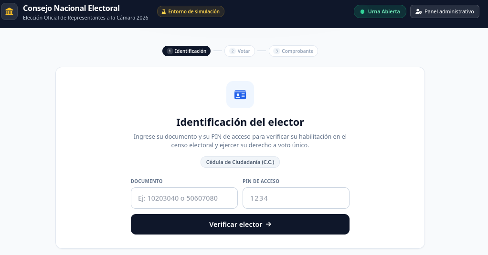
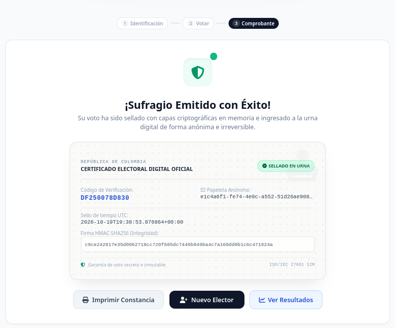
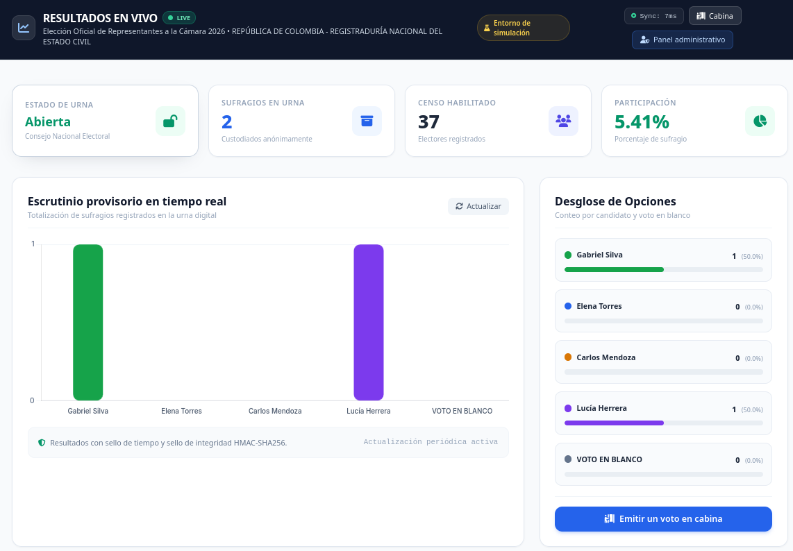
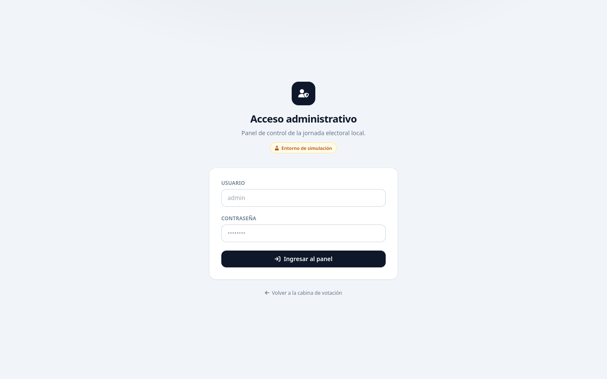

# Manual de uso de la plataforma electoral

## 1. Antes de empezar

Asegúrate de tener Python 3.12 o superior. Activa el entorno virtual e instala las dependencias:

```bash
source venv/bin/activate
pip install -r requirements.txt
```

### 1.1 Configuración del entorno

Si necesitas cambiar credenciales o revisar las variables de entorno, consulta [Configuración y seguridad](configuracion.md). Si no, continúa con el arranque.

### 1.2 Arranque

Desde la raíz del proyecto:

```bash
python3 -m src.main
```

La aplicación queda disponible en los siguientes módulos:

| Módulo | URL |
|---|---|
| Cabina de votación | http://127.0.0.1:8000/ |
| Resultados en vivo | http://127.0.0.1:8000/dashboard |
| Acceso administrativo | http://127.0.0.1:8000/admin/login |
| Documentación de la API | http://127.0.0.1:8000/docs |

### 1.3 Credenciales de demostración

Con estas credenciales sintéticas puedes iniciar sesión en la cabina de votación o en el acceso administrativo.

- **Administrador:** usuario `admin` y contraseña definida en `.env` (por defecto `admin1234`).
- **Electores:** todos usan el PIN `1234`.
- **Documentos nacionales:** `10203040`, `50607080`, `70809010`, `80901020`, `20000002`, etc.
- **Documentos universitarios:** `EST-2024`, `EST-9012`, `EST-3341`, `EST-5520`, `EST-1002`, etc.

| Modalidad | Electores | Habilitados | Inhabilitados |
|---|---:|---:|---|
| Nacional (CNE) | 41 | 37 | `99999999`, `20000001`, `20000013`, `20000025` |
| Universitaria (UDI) | 41 | 37 | `EST-9999`, `EST-1001`, `EST-1013`, `EST-1025` |

> El PIN `1234` es una credencial de simulación. No representa un mecanismo de autenticación de nivel electoral.

---

## 2. Recorrido del elector

### 2.1 Identificación

El elector abre la cabina, escribe su documento dependiendo de la elección que esté habilitada en ese momento, sea UDI o CNE, junto con su respectivo PIN, y pulsa **Verificar elector**.



*Figura 1. Cabina de votación: identificación del elector.*

El sistema valida:

1. Que la jornada esté abierta.
2. Que el formato del documento corresponda a la modalidad.
3. Que el documento exista en el censo y esté habilitado.
4. Que el PIN sea correcto.
5. Que el elector no haya votado ya en esa elección.

Si algo falla, se muestra un mensaje sin revelar si el documento existe o no.

### 2.2 Selección del tarjetón

Una vez verificado, el elector ve el tarjetón oficial con los candidatos y la opción de **Voto en Blanco**.

[Selección del tarjetón](capturas/02_seleccion_tarjeton.png)

*Figura 2. Selección del tarjetón y voto en blanco.*

- Puede seleccionar un candidato o el voto en blanco.
- El botón **Confirmar y emitir sufragio** se habilita solo cuando hay una selección.
- El servidor recibe únicamente el identificador de la opción; el nombre y el partido los resuelve el sistema.

### 2.3 Comprobante

Al confirmar, se muestra un comprobante con:

<!-- Captura pendiente: reemplazar este comentario por  -->

*Figura 3. Comprobante digital del voto.*

- Código de recibo.
- Identificador anónimo de la papeleta.
- Sello de tiempo UTC.
- Sello de integridad HMAC-SHA256.

El comprobante no contiene el documento del votante.

### 2.4 Resultados públicos

El enlace **Ver resultados en vivo** lleva al dashboard:

<!-- Captura pendiente: reemplazar este comentario por  -->

*Figura 4. Panel público de resultados en vivo.*

- Estado de la urna.
- Total de sufragios.
- Censo habilitado.
- Porcentaje de participación.
- Desglose por candidato y voto en blanco.

El dashboard se actualiza cada cinco segundos.

---

## 3. Panel administrativo

### 3.1 Acceso

La ruta `/admin` redirige a `/admin/login` si no hay sesión.



*Figura 5. Acceso al panel administrativo.*

El acceso usa una única cuenta local. La sesión se guarda en una cookie `HttpOnly`; el JavaScript del panel no ve el valor de la sesión.

### 3.2 Funciones del panel

| Función | Qué hace |
|---|---|
| **Cambiar modalidad** | Alterna entre Elección Nacional y Universitaria. Los votos de cada modalidad se conservan por separado. |
| **Control de urna** | Abre o cierra la jornada. Cerrar bloquea nuevos votos; si no se generó acta, se puede volver a abrir. |
| **Cierre y acta** | Cierra la urna, cuenta los votos, calcula el ganador y aplica el sello SHA-256. No se puede deshacer. |
| **Reiniciar jornada** | Borra los votos y participaciones de la elección activa; **conserva el censo**. |
| **Censo electoral** | Lista, inscribe, actualiza y habilita/inhabilita electores. |
| **Bitácora** | Muestra los eventos de verificación, emisión, apertura, cierre, acta y reset. |

> El acta es la finalización de la jornada: después de generarla, la urna queda cerrada y escrutada. Para repetir, usa **Reiniciar jornada**.

> No existe un borrado de voto individual: eso obligaría a vincular identidad y papeleta.


*Figura 6. Panel administrativo: estado de la urna, cierre y acta.*

### 3.3 Actualización automática

- La cabina consulta el estado de la urna cada **5 segundos** y la modalidad cada **10 segundos**. Si el administrador cierra la urna, el botón de verificación se deshabilita y cambia a “Urna cerrada”.
- El dashboard se refresca cada **5 segundos** y cambia su botón de cabina por “Urna cerrada” cuando la jornada está bloqueada.
- El panel administrativo refresca estado, censo y bitácora cada **10 segundos**, sin necesidad de pulsar “Actualizar”.

### 3.4 Qué muestra el acta

Al generar el acta, el panel muestra:

- Total de sufragios.
- Votos por opción.
- Votos en blanco.
- Veredicto según la regla de la modalidad.
- Sello SHA-256 del acta.
- Firmas de jurados registradas.

---

## 4. Solución de problemas

| Síntoma | Causa probable | Solución |
|---|---|---|
| La página no carga | El servidor no está corriendo | Ejecutar `python3 -m src.main` desde la raíz. |
| `ModuleNotFoundError: src` | Se ejecutó `python src/main.py` | Usar `python3 -m src.main`. |
| El elector no puede votar | PIN incorrecto, documento inhabilitado o ya votó | Revisar el censo en el panel; usar otro documento o reiniciar la jornada. |
| El panel redirige al login | Sesión vencida o cookie eliminada | Volver a iniciar sesión. |
| El dashboard muestra 0 votos | La jornada se reinició o no hay votos | Emitir votos de prueba o ejecutar el script de demostración. |
| Error de base de datos bloqueada | Demasiadas escrituras simultáneas en SQLite | Reintentar; para producción se recomienda PostgreSQL. |

**Verificación rápida:** `pytest -q`
